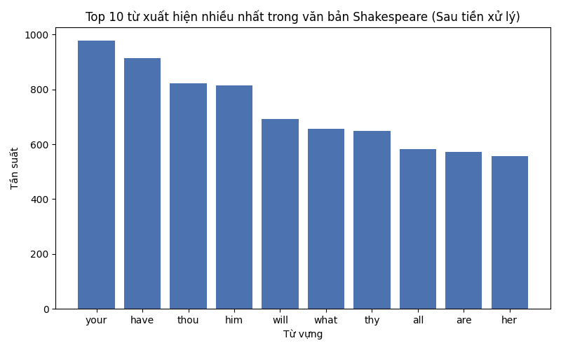
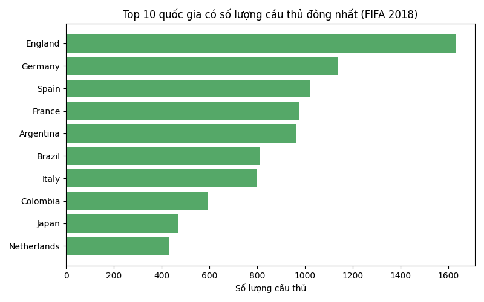
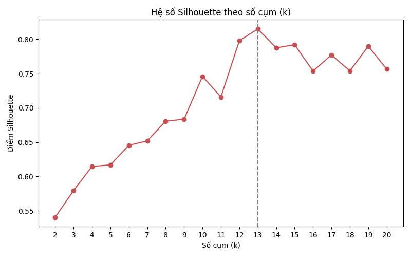
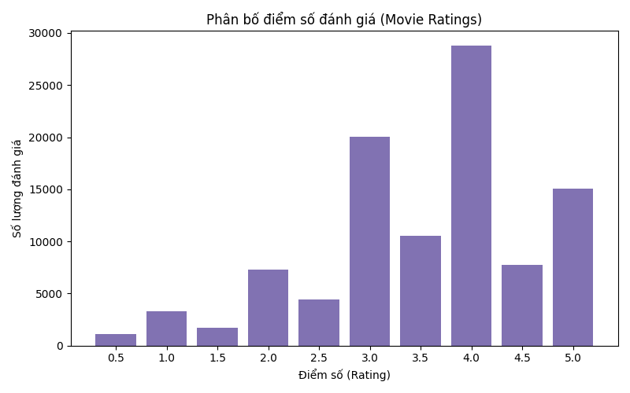
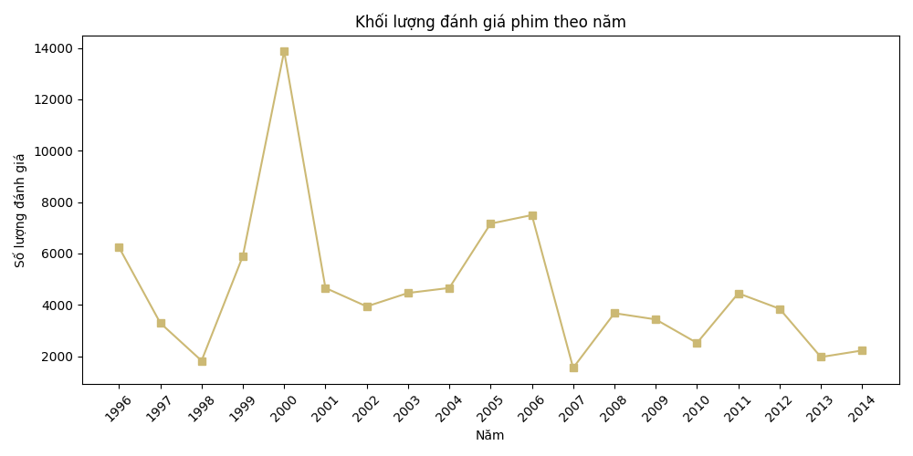

# MỞ ĐẦU

Trong bối cảnh bùng nổ dữ liệu số, việc nắm vững các công cụ điện toán phân tán trở thành kỹ năng thiết yếu đối với sinh viên ngành kinh tế, phân tích dữ liệu và hệ thống thông tin. Báo cáo này tổng hợp quá trình thực hành trên nền tảng **Apache Spark** thông qua giao diện lập trình **PySpark**, nhằm minh chứng khả năng thiết lập môi trường, thao tác trên các mô hình dữ liệu cốt lõi, xây dựng truy vấn phân tích quy mô lớn và triển khai các thuật toán học máy[cite: 2].

Báo cáo được tổ chức theo đúng trình tự phát triển kỹ năng thực tế:
1. **Chương 1 (Các bài tập thực hành cốt lõi):** Đi từ tầng điện toán bậc thấp RDD (xử lý dữ liệu phi cấu trúc văn bản)[cite: 2, 3], chuyển tiếp lên tầng trừu tượng cấp cao DataFrame và Spark SQL (xử lý dữ liệu có cấu trúc)[cite: 2, 4], và bước đầu ứng dụng các mô hình học máy phân cụm (K-Means) cùng phân loại văn bản (Logistic Regression)[cite: 4, 5].
2. **Chương 2 (Bài thực hành tổng hợp):** Đóng vai trò là dự án thu nhỏ, ứng dụng toàn diện các kỹ năng tiền xử lý, kiểm tra tính toàn vẹn dữ liệu, giải quyết 5 câu hỏi nghiệp vụ bằng Spark SQL và triển khai hệ thống tư vấn gợi ý phim (Recommendation System) với thuật toán Phân tích nhân tử ma trận ALS trên tập dữ liệu hơn 100.000 bản ghi[cite: 1, 6].

---

# CHƯƠNG 1: CÁC BÀI TẬP THỰC HÀNH CỐT LÕI (BÀI 1 – BÀI 4)

## 1.1. Môi trường tính toán phân tán và Khởi tạo Spark

Hệ thống được khởi tạo trên nền tảng Python 3.13 và Apache Spark 4.0.4 thông qua giao diện `SparkSession`. Khác với Spark 1.x vốn sử dụng `SparkContext` làm điểm truy cập đơn lẻ cho RDD, từ Spark 2.0 trở đi, `SparkSession` đóng vai trò là điểm kết nối hợp nhất, tích hợp sẵn cả ngữ cảnh SQL và quản lý cấu hình DataFrame.

Cấu hình khởi tạo:
```python
from pyspark.sql import SparkSession

spark = SparkSession.builder \
    .appName("BigDataFundamentals") \
    .master("local[*]") \
    .getOrCreate()
sc = spark.sparkContext

```

* **Ý nghĩa của `master('local[*]')`:** Tham số này chỉ định Spark vận hành ở chế độ cục bộ (local mode), tự động nhận diện và sử dụng toàn bộ các nhân xử lý logic khả dụng của máy tính. Trên môi trường runtime thực nghiệm, `sc.defaultParallelism` trả về giá trị 2, tương ứng với 2 luồng tính toán song song.


* **Cơ chế Thực thi Trì hoãn (Lazy Evaluation):** Khi thực hiện các phép biến đổi như `filter()` hay `map()` trên RDD `sc.parallelize(range(1, 1_000_000))`, Spark không thực thi phép tính ngay mà chỉ xây dựng biểu đồ luồng dữ liệu (Lineage Graph / DAG). Phép tính chỉ thực sự được kích hoạt khi gặp một Action như `take(10)` hoặc `count()`. Cơ chế này cho phép Catalyst Optimizer tối ưu kế hoạch thực thi tổng thể và loại bỏ các bước tính toán dư thừa.


---

## 1.2. Xử lý dữ liệu phi cấu trúc với RDD (Tập dữ liệu Shakespeare)

### 1.2.1. Mục tiêu và Tiền xử lý văn bản

Mục tiêu của bài thực hành là đo lường tần suất xuất hiện của từ vựng (Word Count) trên tác phẩm *Complete Shakespeare* (`Complete Shakespeare.txt`), đồng thời tìm hiểu vai trò của phân vùng dữ liệu (partitioning) trong tính toán phân tán.

Tệp văn bản gốc gồm 18.014 dòng dữ liệu, được Spark nạp mặc định thành 2 phân vùng. Khi thử nghiệm điều chỉnh phân vùng:

* `repartition(n)` thực hiện xáo trộn toàn phần (full shuffle) qua mạng để tái phân phối dữ liệu thành $n$ phân vùng (thử nghiệm thành công với 2, 4 và 8 phân vùng).


* `coalesce(n)` chỉ cho phép gộp các phân vùng liền kề nhằm giảm số lượng phân vùng mà không gây shuffle; do đó khi truyền tham số tăng phân vùng lên 4 hoặc 8, số phân vùng thực tế vẫn giữ nguyên là 2.


Quy trình tiền xử lý văn bản được đóng gói trong hàm `clean_line`:

1. Chuyển đổi toàn bộ văn bản về chữ thường qua hàm `.lower()`.


2. Loại bỏ dấu câu và ký tự đặc biệt bằng biểu thức chính quy: `re.sub(r'[^a-z\s]', ' ', line)`.


3. Tách chuỗi thành danh sách từ, chỉ giữ lại các từ có độ dài từ 3 ký tự trở lên và không nằm trong danh sách Stopwords (các hư từ phổ biến như *the, and, of, to, in, ...*).


```python
clean_words = text_rdd.flatMap(clean_line)
clean_counts = clean_words.map(lambda w: (w, 1)).reduceByKey(lambda a, b: a + b)

```

*Hình 1. Tần suất 10 từ vựng xuất hiện nhiều nhất sau khi làm sạch văn bản Shakespeare.*

*Hình 1* cho thấy các từ như 'your' (978 lần) và 'have' (914 lần) xuất hiện nhiều nhất. Biểu đồ phản ánh rõ hiệu quả của quá trình lọc dữ liệu: các mạo từ hoặc giới từ phổ biến (the, a, in) đã bị loại bỏ hoàn toàn nhờ bước lọc stopwords, chỉ giữ lại các đại từ và động từ mang ý nghĩa cấu trúc cổ.

### 1.2.2. Kết quả phân tích và Ý nghĩa kỹ thuật

Dữ liệu được làm phẳng bằng `flatMap`, ánh xạ thành từng cặp khóa-giá trị `(word, 1)` và gộp tần suất thông qua `reduceByKey`. Bảng 1 trình bày 10 từ xuất hiện nhiều nhất sau khi làm sạch:

*Bảng 1: Top 10 từ xuất hiện nhiều nhất trong văn bản Shakespeare sau làm sạch*

| Thứ hạng | Từ vựng | Số lần xuất hiện | Thứ hạng | Từ vựng | Số lần xuất hiện |
| --- | --- | --- | --- | --- | --- |
| 1 | your | 978 | 6 | what | 656 |
| 2 | have | 914 | 7 | thy | 650 |
| 3 | thou | 822 | 8 | all | 582 |
| 4 | him | 815 | 9 | are | 571 |
| 5 | will | 691 | 10 | her | 556 |

Phân tích theo phân nhóm độ dài từ vựng (Word Length Distribution) ghi nhận:

* Nhóm 1–4 ký tự: 38.746 từ.


* Nhóm 5–8 ký tự: 39.316 từ.


* Nhóm $\ge 9$ ký tự: 5.031 từ.


**Luận giải Kỹ thuật (`groupByKey` so với `reduceByKey`):**
Trong môi trường Big Data, `reduceByKey` vượt trội hơn hẳn `groupByKey`. Khi gọi `groupByKey()`, Spark buộc phải truyền tải toàn bộ các cặp `(key, value)` qua mạng (network shuffle) về node tương ứng rồi mới gom cụm, dễ dẫn đến nghẽn băng thông và lỗi tràn bộ nhớ (Out-of-Memory) nếu một khóa có quá nhiều giá trị. Ngược lại, `reduceByKey()` tự động kích hoạt cơ chế gộp cục bộ (map-side combine) ngay trên từng partition trước khi truyền dữ liệu qua mạng, giảm thiểu tối đa khối lượng dữ liệu di chuyển.

---

## 1.3. Khai phá dữ liệu có cấu trúc bằng DataFrame và Spark SQL (FIFA 2018)

### 1.3.1. Tổng quan cấu trúc và Kiểm tra dữ liệu khuyết

Tập dữ liệu FIFA 2018 (`Fifa2018_dataset.csv`) gồm 17.981 bản ghi và 75 thuộc tính, phản ánh toàn diện thông tin cá nhân, chỉ số kỹ thuật và vị trí thi đấu của cầu thủ chuyên nghiệp.

Kiểm tra tính toàn vẹn dữ liệu cho thấy:

* Cột câu lạc bộ (`Club`) khuyết 248 giá trị.


* Tất cả 26 cột chỉ số vị trí sân cỏ (bao gồm `CAM`, `CB`, `CDM`, `CF`, `CM`, `LAM`, `LB`, ..., `ST`) đều khuyết chính xác 2.029 giá trị.


* *Giải thích nguyên nhân:* 2.029 cầu thủ này là vị trí thủ môn (Goalkeeper - GK); trò chơi FIFA không chấm điểm các chỉ số tấn công và phòng ngự mặt sân đối với thủ môn. Đây là hiện tượng khuyết thiếu logic có chủ đích của dữ liệu thể thao, không phải lỗi thu thập.


### 1.3.2. Kết quả phân tích và So sánh DataFrame API với Spark SQL

Các phân tích nhóm được tiến hành để xác định phân bổ nguồn nhân lực bóng đá:

*Bảng 2: Top 10 quốc gia có số lượng cầu thủ đông nhất trong FIFA 2018*

| Quốc gia | Số lượng cầu thủ | Điểm Overall TB | Điểm Potential TB | Độ tuổi TB |
| --- | --- | --- | --- | --- |
| England | 1.630 | 63,07 | 70,17 | 23,92 |
| Germany | 1.140 | 65,90 | 71,58 | 24,20 |
| Spain | 1.019 | 69,94 | 74,78 | 25,21 |
| France | 978 | 67,29 | 73,02 | 24,63 |
| Argentina | 965 | 67,77 | 72,46 | 25,93 |
| Brazil | 812 | 70,90 | 72,87 | 27,21 |
| Italy | 799 | 66,97 | 71,81 | 25,62 |
| Colombia | 592 | 65,68 | 70,71 | 25,39 |
| Japan | 469 | 62,27 | 65,96 | 26,57 |
| Netherlands | 429 | 68,06 | 73,40 | 24,03 |

Khi phân tích tương quan giữa chỉ số hiện tại (`avg_overall`) và tiềm năng (`avg_potential`) theo câu lạc bộ, kết quả chỉ ra rằng **Overall cao không đồng nghĩa với Potential vượt trội**. Các câu lạc bộ giàu sức trẻ (như Olympique Lyonnais, độ tuổi trung bình 24,6) sở hữu chỉ số Potential trung bình vọt lên rất cao (83,24), trong khi các đội hình có tuổi bình quân cao (như Juventus, 27,77 tuổi) có khoảng cách giữa Overall (81,65) và Potential (84,04) rất hẹp do biên độ phát triển của cầu thủ lớn tuổi đã bão hòa.

**So sánh Thực thi:**
Thực hiện truy vấn lấy Top 10 quốc gia qua hai phương thức:

1. **Spark SQL:** Sử dụng cú pháp khai báo chuẩn trên View tạm thời:
```sql
SELECT Nationality, COUNT(*) AS count 
FROM fifa GROUP BY Nationality ORDER BY count DESC LIMIT 10;

```


2. **DataFrame API:** Sử dụng chuỗi phương thức hàm:
```python
df.groupBy('Nationality').count().orderBy(F.desc('count')).limit(10)

```


Cả hai phương thức cho kết quả giống hệt nhau về mặt số học. Về mặt kiến trúc, cả hai đều đi qua trình biên dịch Catalyst Optimizer để tạo ra cây kế hoạch thực thi vật lý (Physical Execution Plan) tương đương. Tuy nhiên, DataFrame API hỗ trợ kiểm tra kiểu dữ liệu trong IDE và thích hợp cho việc xây dựng các hàm tiền xử lý lồng nhau, trong khi Spark SQL mang lại sự trực quan, thuận tiện cho các nhà phân tích nghiệp vụ.



*Hình 2. Số lượng cầu thủ của 10 quốc gia dẫn đầu trong dữ liệu FIFA 2018.*

*Hình 2* cung cấp cái nhìn trực quan về nguồn nhân lực bóng đá, trong đó đội tuyển Anh (1.630 cầu thủ) và Đức (1.140 cầu thủ) chiếm số lượng áp đảo so với các quốc gia khác. Kết quả truy xuất top 10 quốc gia thông qua Spark SQL và DataFrame API trả về bảng kết quả giống hệt nhau. Điều này chứng minh rằng dù cú pháp khác nhau, Spark vẫn biên dịch chúng qua Catalyst Optimizer để tạo ra cùng một kế hoạch thực thi vật lý tối ưu.

---

## 1.4. Xây dựng Pipeline Machine Learning Cơ bản (Bài 4)

### 1.4.1. Phân cụm không giám sát với K-Means

Bài toán sử dụng tập dữ liệu tọa độ hai chiều `5000_points.txt` gồm 5.000 dòng. Sau khi chuẩn hóa thành vector đặc trưng bằng `VectorAssembler(inputCols=['x', 'y'], outputCol='features')`, thuật toán KMeans được huấn luyện lặp với số cụm $k$ chạy từ 2 đến 20 để xác định số lượng cụm tối ưu dựa trên hệ số Silhouette (đo lường bằng khoảng cách bình phương Euclidean).

*Bảng 3: Diễn biến hệ số Silhouette theo số cụm k*

| $k$ | Silhouette | $k$ | Silhouette | $k$ | Silhouette |
| --- | --- | --- | --- | --- | --- |
| 2 | 0,5405 | 9 | 0,6834 | 15 | 0,7922 |
| 3 | 0,5793 | 10 | 0,7460 | 16 | 0,7538 |
| 4 | 0,6147 | 11 | 0,7158 | 17 | 0,7772 |
| 5 | 0,6169 | 12 | 0,7980 | 18 | 0,7540 |
| 6 | 0,6455 | **13** | **0,8152** | 19 | 0,7900 |
| 7 | 0,6519 | 14 | 0,7876 | 20 | 0,7566 |
| 8 | 0,6808 |  |  |  |  |

Hệ số Silhouette đạt đỉnh tại $k = 13$ với giá trị **0,8152**, minh chứng cấu trúc phân cụm rất rõ nét và tách biệt.

{ width=70% }
*Hình 1: Trực quan hóa kết quả phân cụm K-Means ($k=13$) trên tập 5000_points*

*Cảnh báo kỹ thuật về `toPandas()`:* Để hiển thị Hình 1, dữ liệu dự đoán cần chuyển sang thư viện Matplotlib. Khi gọi `.toPandas()`, Spark sẽ kéo toàn bộ dữ liệu từ các Worker nodes về bộ nhớ RAM của Driver node. Với tập 5.000 điểm, thao tác này an toàn; nhưng với các tập dữ liệu hàng triệu bản ghi, việc chuyển đổi này sẽ làm sập Driver do lỗi Out-of-Memory. Trong thực tế, chỉ nên gọi `.toPandas()` sau khi đã tổng hợp hoặc lấy mẫu (`sample()`).



*Hình 3. Đánh giá chất lượng phân cụm thông qua hệ số Silhouette với k chạy từ 2 đến 20.*

*Hình 3* minh họa quá trình tìm kiếm k tối ưu. Hệ số Silhouette đạt đỉnh (0.8152) tại $k=13$, chứng tỏ đây là số lượng cụm chia cắt dữ liệu hợp lý và chặt chẽ nhất. *(Lưu ý hạn chế: Mặc dù biểu đồ phân tán Scatter Plot của các cụm đã được sinh ra trong Jupyter Notebook, quá trình này yêu cầu gọi hàm `toPandas()`. Việc gọi `toPandas()` trên một tập dữ liệu quá lớn trong thực tế có thể làm cạn kiệt RAM của máy chủ Driver, gây lỗi Out-Of-Memory.)*


### 1.4.2. Phân loại tin nhắn văn bản Spam/Ham với Logistic Regression

Bài toán sử dụng 5.574 tin nhắn văn bản, gồm 747 tin nhắn Spam (nhãn 1.0) và 4.827 tin nhắn Ham (nhãn 0.0). Dữ liệu có tính chất **mất cân bằng nghiêm trọng**: nhãn Ham chiếm tới 86,6%, trong khi Spam chỉ chiếm 13,4%.

Quy trình xử lý được xây dựng khép kín qua `pyspark.ml.Pipeline`:


$$\text{Văn bản thô} \xrightarrow{\text{Tokenizer}} \text{Tokens} \xrightarrow{\text{StopWordsRemover}} \text{Filtered} \xrightarrow{\text{HashingTF}} \text{TF} \xrightarrow{\text{IDF}} \text{Features} \xrightarrow{\text{LogisticRegression}} \text{Dự đoán}$$

Dữ liệu được chia theo tỷ lệ 80% huấn luyện (train) và 20% kiểm định (test) với `seed=42`. Kết quả đánh giá mô hình trên tập kiểm định:

*Bảng 4: Các chỉ số đánh giá mô hình phân loại tin nhắn rác*

| Chỉ số đánh giá | Giá trị | Ý nghĩa thực tiễn |
| --- | --- | --- |
| **Accuracy** | 0,9712 | Tỷ lệ dự đoán đúng tổng thể đạt 97,12%.

 |
| **Weighted Precision** | 0,9712 | Hạn chế tối đa việc phân loại nhầm tin nhắn quan trọng (Ham) vào hòm thư rác.

 |
| **Weighted Recall** | 0,9712 | Đo lường tỷ lệ bắt trúng tin nhắn rác thực tế.

 |
| **Weighted F1-Score** | 0,9712 | Trung bình điều hòa phản ánh tính ổn định cân bằng giữa Precision và Recall.

 |
| **ROC-AUC** | 0,9755 | Năng lực phân tách xác suất giữa hai lớp đạt mức xuất sắc.

 |

**Biện luận về Độ chính xác (Accuracy Paradox):**
Mặc dù Accuracy đạt 97,12%, chỉ số này **không phải là thước đo đáng tin cậy duy nhất** đối với bài toán mất cân bằng. Nếu một mô hình thô sơ luôn đoán tất cả tin nhắn đều là Ham, mô hình đó nghiễm nhiên đạt độ chính xác 86,6% nhưng hoàn toàn vô giá trị vì bỏ lọt 100% tin nhắn rác. Do đó, việc duy trì F1-Score và ROC-AUC vượt mức 0,97 mới là bằng chứng xác thực chứng minh mô hình phân loại chuẩn xác cả hai nhóm tin nhắn.

---

# CHƯƠNG 2: BÀI THỰC HÀNH TỔNG HỢP – HỆ TƯ VẤN ĐIỆN ẢNH VỚI MOVIE RATINGS VÀ ALS

## 2.1. Đặc tả Tập dữ liệu và Tiền xử lý

Bài thực hành tổng hợp giải quyết bài toán tư vấn cá nhân hóa (Collaborative Filtering) trên tập dữ liệu đánh giá phim lớn.

* **Nguồn gốc dữ liệu:** Tập dữ liệu được cung cấp dưới tệp `Movie ratings.csv`. Dựa trên quy mô (100.004 bản ghi, 4 cột) và miền giá trị, tập dữ liệu này có cấu trúc tương thích tuyệt đối với tập dữ liệu nghiên cứu kinh điển **MovieLens 100K** của GroupLens Research. (*Ghi chú học thuật: Cần đối soát lại với tài liệu handout chính thức để xác nhận định danh nguồn phát hành*).


* **Kích thước và Schema:** Gồm 100.004 dòng và 4 cột dữ liệu:
* `userId` (integer): Mã định danh duy nhất của người dùng.


* `movieId` (integer): Mã định danh duy nhất của bộ phim.


* `rating` (double): Điểm số đánh giá, trải dài từ 0.5 đến 5.0.


* `timestamp` (integer): Thời điểm đánh giá (định dạng Unix epoch).


* **Giá trị thiếu:** Toàn bộ 4 cột dữ liệu đều đạt tỷ lệ nguyên vẹn 100%, không xuất hiện giá trị khuyết (0 null values).


* **Tạo thuộc tính mới:** Áp dụng `withColumn` và hàm thời gian `from_unixtime` để trích xuất năm đánh giá (`rating_year`) phục vụ phân tích xu hướng:
```python
ratings_clean = ratings.na.drop() \
    .withColumn('rating_year', F.year(F.from_unixtime('timestamp')))
ratings_clean.createOrReplaceTempView('ratings_view')

```


---

## 2.2. Năm câu hỏi phân tích dữ liệu và Truy vấn Spark SQL

Năm câu hỏi phân tích được thiết kế nhằm khai phá toàn diện các góc nhìn: phân bổ điểm số, chất lượng tác phẩm, hành vi người dùng, chu kỳ lịch sử và mức độ phân cực cộng đồng.

### Câu hỏi 1: Sự phân bổ điểm số đánh giá phản ánh thói quen chấm điểm nào của cộng đồng?

*Truy vấn SQL:*

```sql
SELECT rating, COUNT(*) AS total_votes
FROM ratings_view
GROUP BY rating
ORDER BY rating DESC;

```

*Kết quả và Ý nghĩa:*
Cộng đồng có xu hướng thiên vị tích cực rõ rệt. Mức điểm phổ biến nhất là 4.0 (28.750 lượt) và 3.0 (20.064 lượt), tiếp theo là điểm tuyệt đối 5.0 (15.095 lượt). Ngược lại, các mức điểm tiêu cực như 0.5 (1.101 lượt) và 1.5 (1.687 lượt) chiếm tỷ lệ rất thấp. Điều này chứng tỏ người dùng có xu hướng chỉ chủ động đánh giá những bộ phim họ yêu thích hoặc đáp ứng được kỳ vọng giải trí.

### Câu hỏi 2: Những tác phẩm nào đạt chất lượng xuất sắc nhất nhưng vẫn đảm bảo tính khách quan (tối thiểu 50 lượt đánh giá)?

*Truy vấn SQL:*

```sql
SELECT movieId, COUNT(*) AS total_votes, ROUND(AVG(rating), 2) AS avg_score
FROM ratings_view
GROUP BY movieId
HAVING COUNT(*) >= 50
ORDER BY avg_score DESC, total_votes DESC
LIMIT 10;

```

*Kết quả và Ý nghĩa:*
Điều kiện `HAVING COUNT(*) >= 50` là mắt xích nghiệp vụ quan trọng nhằm loại bỏ các bộ phim chỉ nhận một vài điểm 5 tuyệt đối ngẫu nhiên từ nhóm nhỏ khán giả thiên lệch. Bảng 5 chỉ ra hai bộ phim dẫn đầu tuyệt đối là phim mã số 318 (*The Shawshank Redemption*, 311 lượt đánh giá, điểm trung bình 4,49) và phim 858 (*The Godfather*, 200 lượt đánh giá, điểm trung bình 4,49).

*Bảng 5: Top 10 bộ phim có điểm số đánh giá trung bình cao nhất ($\ge 50$ lượt vote)*

| Mã phim (`movieId`) | Lượt đánh giá (`total_votes`) | Điểm trung bình (`avg_score`) |
| --- | --- | --- |
| 318 | 311 | 4,49 |
| 858 | 200 | 4,49 |
| 969 | 50 | 4,42 |
| 1221 | 135 | 4,39 |
| 913 | 62 | 4,39 |
| 50 | 201 | 4,37 |
| 1228 | 50 | 4,35 |
| 1252 | 76 | 4,34 |
| 904 | 92 | 4,32 |
| 527 | 244 | 4,30 |

### Câu hỏi 3: Hoạt động đánh giá của nền tảng biến động như thế nào theo thời gian?

*Truy vấn SQL:*

```sql
SELECT rating_year, COUNT(*) AS total_reviews
FROM ratings_view
GROUP BY rating_year
ORDER BY rating_year ASC;

```

*Kết quả và Ý nghĩa:*
Hệ thống bắt đầu ghi nhận dữ liệu từ năm 1995 với vỏn vẹn 3 lượt đánh giá, tăng vọt vào năm 1996 (6.239 lượt) và đạt đỉnh điểm lịch sử vào năm 2000 với **13.869 lượt đánh giá**. Sau giai đoạn bùng nổ đầu thập niên 2000, số lượng đánh giá duy trì ổn định trong khoảng 2.000 đến 4.500 lượt mỗi năm. Kết quả này cho thấy tập dữ liệu phản ánh rất rõ thời kỳ phổ biến internet băng thông rộng và sự phát triển mạnh mẽ của các diễn đàn chia sẻ phim đầu thế kỷ 21.

### Câu hỏi 4: Nhóm người dùng hoạt động tích cực nhất (Super-users) có hành vi chấm điểm như thế nào?

*Truy vấn SQL:*

```sql
SELECT userId, COUNT(*) AS movies_rated, ROUND(AVG(rating), 2) AS user_avg_rating
FROM ratings_view
GROUP BY userId
ORDER BY movies_rated DESC
LIMIT 10;

```

*Kết quả và Ý nghĩa:*
Nhóm 10 người dùng tích cực nhất đóng góp từ 1.011 đến 2.391 lượt đánh giá mỗi người (đứng đầu là User 547 với 2.391 phim, User 564 với 1.868 phim). Đáng chú ý, điểm trung bình của nhóm này dao động quanh mức **2,62 – 3,77**, thấp hơn đáng kể so với mức điểm bình quân chung toàn hệ thống (~3,54). Điều này phản ánh tâm lý học hành vi: những khán giả xem nhiều phim thường khắt khe và có gu thẩm mỹ phân hóa hơn nhóm người dùng thông thường.

### Câu hỏi 5: Những bộ phim nào gây tranh cãi gay gắt nhất trong cộng đồng người xem?

*Truy vấn SQL:*

```sql
SELECT movieId, COUNT(*) AS total_votes, ROUND(STDDEV(rating), 2) AS rating_stddev
FROM ratings_view
GROUP BY movieId
HAVING COUNT(*) >= 30
ORDER BY rating_stddev DESC
LIMIT 10;

```

*Kết quả và Ý nghĩa:*
Bằng cách đo lường độ lệch chuẩn (`STDDEV`), hệ thống bóc tách các tác phẩm gây phân cực quan điểm. Bộ phim mã số 8957 (33 lượt) có độ lệch chuẩn cao nhất là **1,38**, tiếp theo là phim 122882 (stddev = 1,36) và phim 2710 (stddev = 1,32). Độ lệch chuẩn lớn hơn 1,3 chỉ ra sự đối đầu trực tiếp giữa hai luồng ý kiến: một nhóm khán giả đánh giá điểm chạm đáy (1–2 sao) và nhóm đối lập chấm điểm tuyệt đối (4–5 sao).



Hình 4. Khối lượng đánh giá theo từng thang điểm.

Hình 4 cho thấy dữ liệu có xu hướng lệch trái nhẹ (left-skewed), tập trung rất lớn vào các mức điểm 4.0 và 3.0. Điều này phản ánh tâm lý người dùng thường chỉ chủ động để lại đánh giá cho những bộ phim họ thực sự quan tâm hoặc có chất lượng tốt.



Hình 5. Tổng số lượng đánh giá phim qua từng năm.

Hình 5 vẽ lại kết quả của truy vấn gom nhóm theo rating_year. Nền tảng ghi nhận sự bùng nổ vượt bậc vào năm 2000 với 13.869 lượt đánh giá, sau đó duy trì mức ổn định quanh 2.000 đến 7.000 lượt từ sau năm 2001.

---

## 2.3. Xây dựng và Đánh giá Mô hình Gợi ý Phim ALS

### 2.3.1. Nguyên lý và Thiết lập mô hình

Thuật toán **Alternating Least Squares (ALS)** giải quyết bài toán Lọc cộng tác (Collaborative Filtering) bằng kỹ thuật phân tích ma trận. Ma trận đánh giá thưa $R$ (kích thước $M \times N$) được xấp xỉ thành tích của hai ma trận nhân tử tiềm ẩn bậc thấp: Ma trận người dùng $U$ ($M \times k$) và Ma trận vật phẩm $V$ ($N \times k$):


$$R \approx U \times V^T$$

Hàm mục tiêu tối ưu hóa có dạng:


$$\min_{U, V} \sum_{i, j \in \text{Observed}} (R_{ij} - u_i^T v_j)^2 + \lambda \left( \sum_i \Vert{}u_i\Vert{}_2^2 + \sum_j \Vert{}v_j\Vert{}_2^2 \right)$$

Thiết lập thuật toán trong PySpark:

```python
from pyspark.ml.recommendation import ALS
from pyspark.ml.evaluation import RegressionEvaluator

train_data, test_data = ratings_clean.randomSplit([0.8, 0.2], seed=42)

als = ALS(
    userCol='userId',
    itemCol='movieId',
    ratingCol='rating',
    nonnegative=True,
    coldStartStrategy='drop',
    rank=10,
    maxIter=10
)
model = als.fit(train_data)
predictions = model.transform(test_data)

```

* `rank=10`: Số lượng đặc trưng tiềm ẩn (latent factors) được chọn là 10, cân bằng giữa khả năng nắm bắt sở thích và chi phí bộ nhớ.


* `coldStartStrategy='drop'`: Trong tập kiểm định, nếu xuất hiện người dùng hoặc bộ phim chưa từng có mặt ở tập huấn luyện, Spark sẽ tự động loại bỏ các giá trị dự đoán `NaN` này để đảm bảo việc tính toán sai số không bị gián đoạn.


### 2.3.2. Đánh giá Sai số và Trực quan hóa

Đánh giá mức độ sai lệch bằng công cụ `RegressionEvaluator` với thước đo RMSE (Root Mean Square Error):

```python
evaluator = RegressionEvaluator(metricName='rmse', labelCol='rating', predictionCol='prediction')
rmse = evaluator.evaluate(predictions)
# Kết quả thực nghiệm: RMSE = 0.9128

```

Chỉ số **$\text{RMSE} = 0,9128$** thể hiện rằng trung bình mức dự báo của mô hình lệch khoảng **0,91 sao** so với điểm thực tế. Trên thang đo từ 0,5 đến 5,0 sao, mức sai lệch dưới 1 sao là kết quả chấp nhận được đối với mô hình ALS baseline chạy ở cấu hình mặc định chưa qua tinh chỉnh siêu tham số (Hyperparameter Tuning bằng Cross-Validation).

{ width=75% }
*Hình 2: Biểu đồ phân tán so sánh Điểm thực tế và Điểm dự đoán của mô hình ALS (Lấy mẫu 1%)*

Hình 2 trực quan hóa độ tương quan giữa điểm thực tế và dự đoán. Đường đứt nét màu cam biểu thị đường chuẩn lý tưởng ($y = x$). Dễ nhận thấy các điểm dự báo phân bố tập trung bám sát đường chuẩn ở khoảng điểm 3.0 đến 4.5.

### 2.3.3. Thực nghiệm Gợi ý Phim cho Người dùng cụ thể (User #42)

Hệ thống sử dụng phương thức `recommendForUserSubset` để trích xuất 5 bộ phim có điểm số dự báo cao nhất cho người dùng đại diện là User #42:

*Bảng 6: Danh mục 5 bộ phim được hệ thống gợi ý cho User #42*

| Mã người dùng (`userId`) | Mã phim được gợi ý (`movieId`) | Điểm dự đoán (`predicted_rating`) |
| --- | --- | --- |
| 42 | 83411 | 5,73 |
| 42 | 83359 | 5,73 |
| 42 | 83318 | 5,73 |
| 42 | 67504 | 5,73 |
| 42 | 80599 | 5,16 |

> **Bình luận Học thuật về Hiện tượng Vượt thang điểm (Out-of-Bounds Anomaly):**
> Trong Bảng 6, điểm số dự đoán của mô hình đạt mức **5,73** và **5,16**, vượt quá mức điểm trần tối đa là 5,0 của hệ thống đánh giá.
> *Nguyên nhân kỹ thuật:* Thuật toán ALS giải bài toán tối ưu bình phương tối thiểu không ràng buộc trên miền giá trị thực ($U \times V^T \in \mathbb{R}$). Mặc dù tham số `nonnegative=True` đã khống chế các nhân tử không âm (tránh điểm âm), hàm mục tiêu vẫn không có chặn trên sigmoid hay hàm kẹp (clipping penalty).
> *Giải pháp thực tế:* Trong triển khai sản xuất, một bước hậu xử lý (post-processing clip) luôn được bổ sung để đưa mọi dự đoán vượt ngưỡng về khoảng hợp lệ: $\hat{R}_{ij} = \min(\max(\hat{R}_{ij}, 0.5), 5.0)$.
> 
> 

---

# KẾT LUẬN

Báo cáo đã tổng kết toàn bộ quá trình thực hành trên nền tảng PySpark, đáp ứng đầy đủ các tiêu chuẩn kỹ thuật đề ra[cite: 1, 2]:

1. **Về mặt kiến trúc:** Làm chủ cơ chế Lazy Evaluation, quản lý phân vùng dữ liệu và hiểu rõ sự khác biệt giữa các phép biến đổi hẹp và rộng (`reduceByKey` vs `groupByKey`).


2. **Về mặt phân tích:** Phối hợp linh hoạt DataFrame API và Spark SQL để tiền xử lý và trích xuất các insight có ý nghĩa từ các tập dữ liệu có cấu trúc lớn.


3. **Về mặt học máy:** Triển khai hoàn chỉnh cả ba hướng tiếp cận cốt lõi: Phân cụm không giám sát (K-Means), Phân loại có giám sát (Logistic Regression với NLP Pipeline) và Hệ thống gợi ý lọc cộng tác (ALS)[cite: 1, 5, 6].
4. **Kinh nghiệm thực tiễn:** Nhận thức rõ ràng các giới hạn vận hành phân tán, đặc biệt là nguy cơ tràn bộ nhớ khi lạm dụng `collect()` hoặc `toPandas()`, cũng như hiện tượng mất cân bằng dữ liệu trong đánh giá độ chính xác mô hình[cite: 1, 5, 6].


