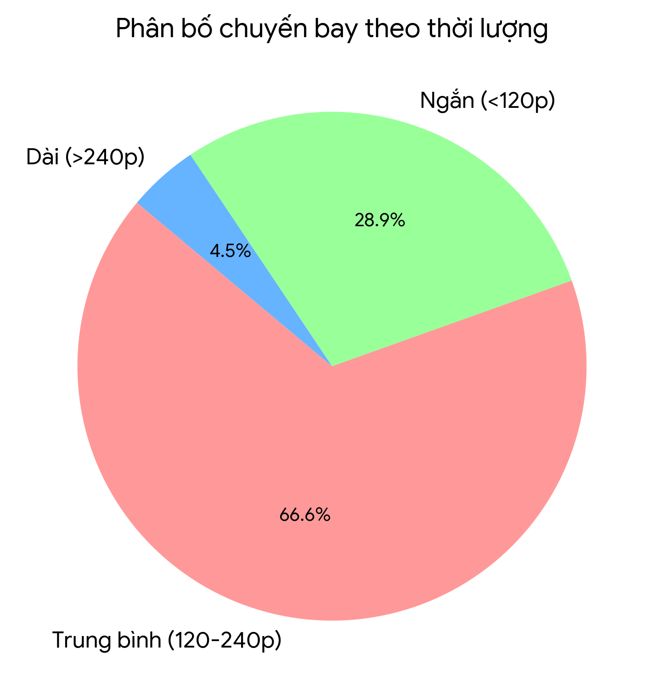
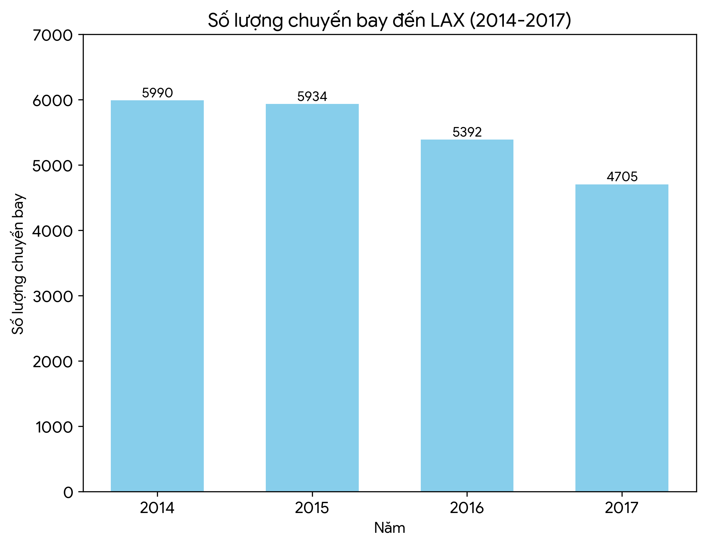
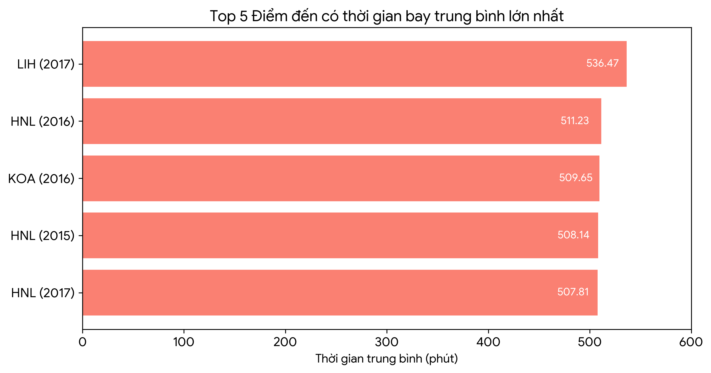

# Mở đầu

Báo cáo này trình bày các phương pháp làm sạch, biến đổi và tối ưu hoá xử lý dữ liệu sử dụng PySpark. Các kỹ thuật được thực hành bao gồm định nghĩa Schema, các thao tác trên cột, sử dụng UDF, phân vùng dữ liệu, Caching và Join tối ưu. Dữ liệu phân tích bao gồm hồ sơ chuyến bay của American Airlines (2014-2017) và dữ liệu bầu cử hội đồng thành phố Dallas.

## Chương 1: Chuẩn bị và Làm sạch Dữ liệu

- **Khởi tạo Schema**: Việc định nghĩa Schema rõ ràng (Explicit Schema) bằng `StructType` giúp Spark bỏ qua bước suy luận kiểu dữ liệu, từ đó tăng tính nhất quán và tối ưu thời gian quét file.
- **Thao tác trên Cột**: Các hàm trong `pyspark.sql.functions` như `when`, `split`, `trim`, `upper` được sử dụng để tách First Name/Last Name, chuẩn hoá chữ hoa/thường và gắn cờ dữ liệu.
- **User-Defined Functions (UDF)**: Áp dụng UDF Python để xử lý các logic phức tạp như đếm số từ trong tên. Tuy nhiên, hàm tích hợp (built-in) luôn được ưu tiên khi có thể nhằm đạt hiệu năng tối đa.
- **Validation**: Ứng dụng `left_anti` join để lọc và kiểm tra các phiếu bầu không hợp lệ trong dữ liệu hội đồng thành phố Dallas.

## Chương 2: Tối ưu hoá Thực thi (Execution Optimization)

- **Lazy Evaluation và Immutability**: Spark trì hoãn quá trình thực thi cho đến khi gọi một *Action* (`.show()`, `.count()`). Việc này cho phép Catalyst Optimizer tối ưu hoá kế hoạch truy vấn (Execution Plan).
- **Lưu trữ Parquet**: Dữ liệu trung gian được chuyển sang dạng Parquet. Định dạng lưu trữ theo cột (columnar) này không chỉ bảo tồn Schema mà còn hỗ trợ nén, lọc cột hiệu quả và hạn chế Predicate Pushdown.
- **Cache**: Việc lưu trữ DataFrame `voter_df` vào bộ nhớ đệm giúp giảm thời gian truy vấn `groupBy` từ 0.7972 giây xuống chỉ còn 0.2387 giây.
- **Broadcast Join**: Bảng thông tin sân bay nhỏ được nạp vào bộ nhớ các Worker thông qua `F.broadcast()`, giúp giảm thiểu chi phí Shuffle qua mạng.

## Chương 3: Phân tích Dữ liệu Chuyến bay (2014-2017)

Tập dữ liệu gồm 583,718 chuyến bay được gộp từ 4 tệp CSV. Quá trình làm sạch đã loại bỏ các chuyến bay có thời gian không hợp lệ, đồng thời tính toán các chỉ số thống kê chi tiết theo năm và điểm đến.

### 3.1 Phân bố thời lượng chuyến bay

Dựa vào thời gian bay (`elapsed_minutes`), các chuyến bay được phân thành ba nhóm: Ngắn (<120 phút), Trung bình (120-240 phút) và Dài (>240 phút).

*Hình 1. Phần lớn các chuyến bay (66.6%) thuộc nhóm Trung bình, trong khi nhóm Dài chỉ chiếm 4.5%.*

### 3.2 Điểm đến bận rộn nhất

Phân tích cho thấy sân bay LAX (Los Angeles) duy trì vị thế là điểm đến có nhiều chuyến bay nhất trong cả 4 năm, mặc dù tổng lưu lượng có xu hướng sụt giảm.

*Hình 2. Số lượng chuyến bay đến LAX đạt đỉnh vào năm 2014 với 5,990 chuyến và giảm xuống còn 4,705 chuyến vào năm 2017.*

### 3.3 Sân bay có thời gian bay trung bình dài nhất

Các điểm đến tại khu vực Hawaii (LIH, HNL, KOA, OGG) chiếm toàn bộ các vị trí dẫn đầu về thời gian bay trung bình.

*Hình 3. Chuyến bay đến LIH (Lihue) năm 2017 ghi nhận kỷ lục với thời gian bay trung bình lên tới 536.47 phút.*

## Kết luận

Báo cáo đã mô phỏng thành công quy trình xử lý dữ liệu lớn (Pipeline) toàn diện: Đọc → Xác thực → Làm sạch → Biến đổi → Phân tích → Xuất. Việc áp dụng đúng lúc các kỹ thuật tối ưu như Schema Definition, Caching và Broadcast Join giúp nâng cao rõ rệt năng lực tính toán và phân tích của PySpark.
