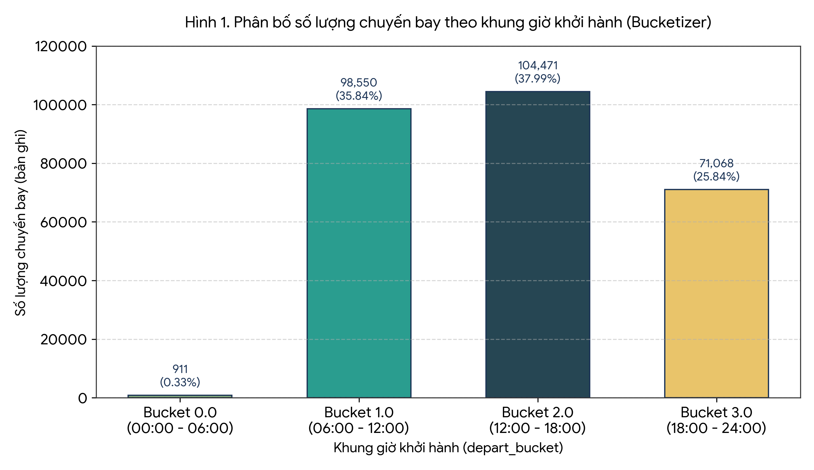
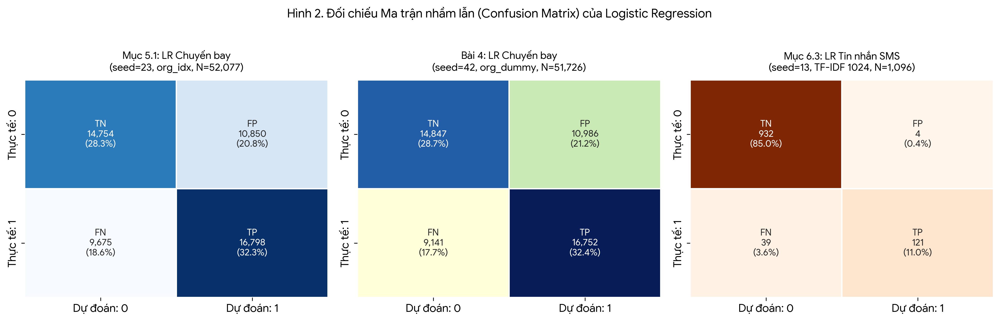
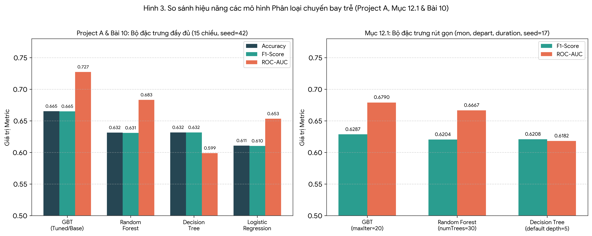
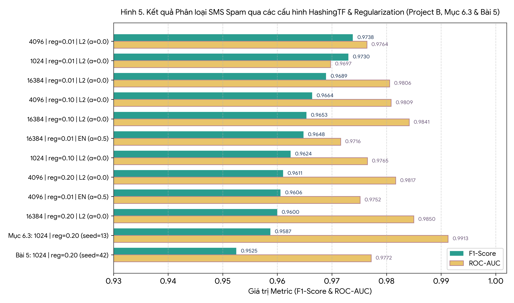
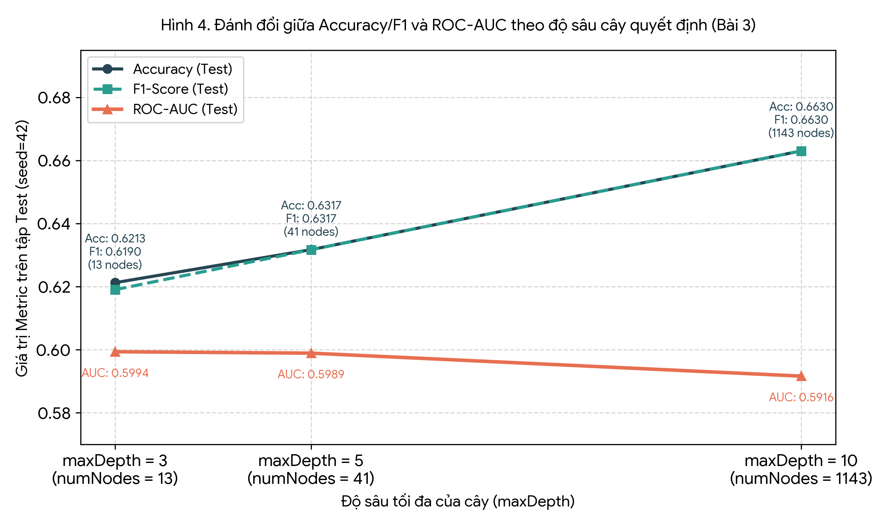
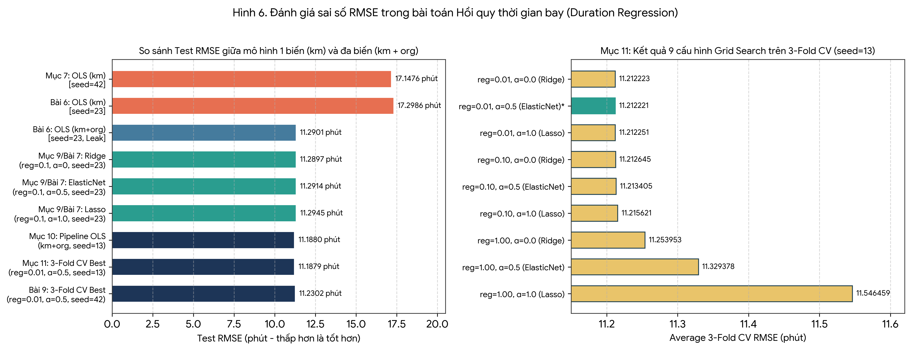

## MỞ ĐẦU

### 1. Bối cảnh và Mục tiêu thực hành
Trong các hệ thống phân tích dữ liệu kinh doanh và vận hành hiện đại, khối lượng bản ghi nhật ký giao dịch, lịch trình vận tải hoặc văn bản người dùng thường vượt quá giới hạn bộ nhớ và năng lực tính toán đơn luồng của một máy tính cá nhân. Apache Spark giải quyết bài toán này thông qua kiến trúc tính toán phân tán trong bộ nhớ (in-memory distributed computing), cho phép chia nhỏ dữ liệu trên cụm máy chủ (cluster) và thực thi song song các phép biến đổi. Thư viện `pyspark.ml` cung cấp giao diện lập trình hướng DataFrame (DataFrame-based API) giúp chuẩn hóa toàn bộ vòng đời học máy: từ đọc dữ liệu, tiền xử lý, trích xuất đặc trưng (feature engineering), đóng gói quy trình (`Pipeline`), đến huấn luyện mô hình và tinh chỉnh siêu tham số bằng kiểm định chéo (`CrossValidator`).

Bài báo cáo này tài liệu hóa, kiểm chứng và phân tích chuyên sâu toàn bộ quá trình thực hiện bài tập **Máy học với PySpark** dựa trên notebook đã hoàn thành (`Machine_Learning_with_PySpark.ipynb`) và đề bài hướng dẫn (`Machine_Learning_with_PySpark.pdf`). Các mục tiêu kỹ thuật trọng tâm bao gồm:
1. Xây dựng quy trình làm sạch, biến đổi đặc trưng và mã hóa biến phân loại bằng `StringIndexer`, `OneHotEncoder`, `Bucketizer` và `VectorAssembler` trên Spark DataFrame.
2. Huấn luyện và đánh giá các mô hình phân loại nhị phân (`DecisionTreeClassifier`, `LogisticRegression`, `RandomForestClassifier`, `GBTClassifier`) dự đoán tình trạng trễ chuyến bay thông qua Confusion Matrix, Accuracy, Precision, Recall, F1-Score và ROC-AUC.
3. Triển khai đường ống khai phá văn bản (Text Mining) gồm `regexp_replace`, `Tokenizer`, `StopWordsRemover`, `HashingTF` và `IDF` kết hợp `LogisticRegression` để phát hiện tin nhắn rác (SMS Spam).
4. Xây dựng mô hình hồi quy tuyến tính (`LinearRegression`) dự báo thời gian bay (`duration`), đánh giá qua RMSE, MAE, MSE, $R^2$, đồng thời khảo sát tác động của điều chuẩn L2 (Ridge), L1 (Lasso) và Elastic Net.
5. Thiết kế `Pipeline` học máy chuẩn mực nhằm ngăn chặn hiện tượng rò rỉ dữ liệu (data leakage) và thực hiện tìm kiếm lưới siêu tham số (`ParamGridBuilder`) kết hợp kiểm định chéo 3-fold (`CrossValidator`).

### 2. Phạm vi dữ liệu
Bài thực hành sử dụng hai tập dữ liệu thực tế được tải từ kho lưu trữ học phần về thư mục `/content/data`:
- **`flights-larger.csv`**: Tập dữ liệu lịch trình và vận hành chuyến bay thương mại gồm **275.000 bản ghi** và **10 thuộc tính**, phục vụ cả bài toán phân loại chuyến bay trễ ($\text{delay} \ge 15$ phút) lẫn bài toán hồi quy dự đoán thời gian bay (`duration`).
- **`sms.csv`**: Tập dữ liệu tin nhắn văn bản định dạng phân tách bằng dấu chấm phẩy (`;`), không có dòng tiêu đề, gồm 3 trường (`id`, `text`, `label`), phục vụ bài toán phân loại văn bản nhị phân (0 = tin nhắn thường / ham, 1 = tin nhắn rác / spam).

---

## CHƯƠNG 1: MÔI TRƯỜNG THỰC THI, KHẢO SÁT VÀ CHUẨN BỊ DỮ LIỆU (MỤC 1 – 3)

### 1.1. Khởi tạo môi trường Apache Spark
Ở phần mở đầu của notebook (Cell 1–4), dữ liệu được tải về thông qua cơ chế `git sparse-checkout` chỉ lấy thư mục `Baitap03/data` để tiết kiệm băng thông. Phiên làm việc `SparkSession` được khởi tạo với cấu hình:
- **Phiên bản PySpark / Spark:** `4.0.4`
- **Chế độ thực thi (`master`):** `local[*]` — cho phép Spark sử dụng toàn bộ số nhân CPU khả dụng trên máy cục bộ để thực thi song song các tác vụ phân vùng (partitions).
- **Tên ứng dụng (`appName`):** `MachineLearningWithPySpark`

### 1.2. Khảo sát dữ liệu chuyến bay (`flights-larger.csv`) và Xử lý giá trị khuyết
Tập dữ liệu `flights-larger.csv` được đọc bằng `spark.read.csv(..., header=True, inferSchema=True, nullValue="NA")` (Cell 5). Việc truyền tham số `nullValue="NA"` rất quan trọng vì trong file CSV gốc, các chuyến bay bị hủy hoặc không ghi nhận được độ trễ được ký hiệu bằng chuỗi `"NA"`; nếu không khai báo tham số này, Spark sẽ suy diễn cột `delay` thành kiểu chuỗi (`string`) thay vì số nguyên (`integer`).

Kết quả kiểm tra cấu trúc (`printSchema()`) và đếm giá trị khuyết trên từng cột (Cell 8) trên tổng số **275.000 bản ghi** được tổng hợp trong Bảng 1:

**Bảng 1. Cấu trúc Schema, ý nghĩa các biến và thống kê giá trị khuyết của `flights-larger.csv`**

| Tên cột | Kiểu dữ liệu Spark | Nullable | Ý nghĩa kinh tế / vận hành | Số giá trị Null (`NA`) | Tỷ lệ khuyết (%) |
|---|---|---|---|---:|---:|
| `mon` | `integer` | `true` | Tháng khởi hành trong năm ($1 \rightarrow 12$) | 0 | 0,00% |
| `dom` | `integer` | `true` | Ngày trong tháng ($1 \rightarrow 31$) | 0 | 0,00% |
| `dow` | `integer` | `true` | Ngày trong tuần ($0 \rightarrow 6$) | 0 | 0,00% |
| `carrier` | `string` | `true` | Mã hãng hàng không vận chuyển (VD: `OO`, `B6`, `WN`, `UA`, `US`, `AA`) | 0 | 0,00% |
| `flight` | `integer` | `true` | Số hiệu chuyến bay định danh (VD: `5836`, `199`) | 0 | 0,00% |
| `org` | `string` | `true` | Mã IATA sân bay xuất phát (8 sân bay: `ORD`, `SFO`, `JFK`, `LGA`, `SJC`, `SMF`, `OGG`, `TUS`) | 0 | 0,00% |
| `mile` | `integer` | `true` | Quãng đường bay tính theo dặm Anh (miles) | 0 | 0,00% |
| `depart` | `double` | `true` | Giờ khởi hành dự kiến dạng thập phân ($0.0 \rightarrow 24.0$, VD: `8.18`, `21.17`) | 0 | 0,00% |
| `duration` | `integer` | `true` | Thời gian bay dự kiến tính bằng phút (VD: `51`, `365`) | 0 | 0,00% |
| `delay` | `integer` | `true` | Độ trễ thực tế khi khởi hành tính bằng phút (âm nếu bay sớm) | **16.711** | **6,08%** |

**Phân tích quyết định làm sạch và chuẩn bị dữ liệu (Mục 2.2 - Cell 10):**
Trong Cell 10, DataFrame `flights_ml` được tạo ra qua chuỗi biến đổi:
1. **Loại bỏ cột `flight` (`.drop("flight")`):** Số hiệu chuyến bay là mã định danh quản lý hành chính (identifier), mang số lượng giá trị duy nhất rất lớn nhưng không phản ánh bản chất vật lý hay quy luật trễ chuyến. Giữ lại biến này sẽ gây nhiễu hoặc làm tăng chiều dữ liệu vô ích.
2. **Lọc bỏ giá trị khuyết (`.filter(F.col("delay").isNotNull()).dropna()`):** Vì `delay` là biến cơ sở để xây dựng nhãn mục tiêu (`label`) cho bài toán phân loại có giám sát, **16.711 bản ghi** (chiếm 6,08%) không có thông tin `delay` bắt buộc phải loại bỏ để tránh gán nhãn sai. Sau bước lọc này, tập dữ liệu sạch còn lại chính xác **258.289 bản ghi** ($275.000 - 16.711 = 258.289$, được xác nhận lại tại Cell 16 khi tổng mẫu Train + Test bằng $206.212 + 52.077 = 258.289$ và in trực tiếp tại Cell 57).
3. **Chuyển đổi đơn vị đo lường (`mile` $\rightarrow$ `km`):** Quãng đường bay được chuyển từ dặm sang kilômét và làm tròn đến hàng đơn vị theo công thức:
   $$\text{km} = \text{round}(\text{mile} \times 1,60934,\ 0)$$
   Sau đó cột `mile` gốc được loại bỏ (`.drop("mile")`) để tránh hiện tượng đa cộng tuyến hoàn hảo (perfect multicollinearity) giữa hai biến đo cùng một đại lượng vật lý.
4. **Tạo nhãn phân loại nhị phân (`label`):** Theo chuẩn thống kê hàng không thương mại (FAA), một chuyến bay được coi là trễ nếu chậm từ 15 phút trở lên:
   $$\text{label} = \mathbb{I}(\text{delay} \ge 15) \in \{0, 1\}$$
   Trong đó `label = 1` biểu thị chuyến bay trễ ($\ge 15$ phút) và `label = 0` biểu thị chuyến bay đúng giờ hoặc bay sớm ($\text{delay} < 15$, bao gồm cả các giá trị âm như `-19`, `-10`).

### 1.3. Khảo sát dữ liệu văn bản `sms.csv` với Schema tường minh (Mục 1.3 - Cell 7)
Khác với `flights-larger.csv`, file `sms.csv` không có dòng tiêu đề (`header=False`) và sử dụng dấu chấm phẩy (`sep=";"`) làm ký tự phân cách. Thay vì dùng `inferSchema=True` (vốn tốn thêm một lượt quét toàn bộ file và có thể đoán sai kiểu dữ liệu), notebook định nghĩa tường minh `StructType` (Cell 7):
```python
sms_schema = StructType([
    StructField("id", IntegerType(), True),
    StructField("text", StringType(), True),
    StructField("label", IntegerType(), True)
])
```
Kết quả 5 dòng đầu cho thấy dữ liệu văn bản gốc chứa nhiều chữ hoa, chữ thường, dấu câu (`'`, `.`, `!`, `...`) và chuỗi số điện thoại/tiền thưởng (`0800 542 0578`, `1000`, `5000`), đòi hỏi phải có quy trình chuẩn hóa văn bản ở Chương 3.

### 1.4. Mã hóa biến phân loại và Gom cụm vector đặc trưng (Mục 3.1 – 3.4)
Các thuật toán học máy trong Spark MLlib thực hiện các phép toán đại số tuyến tính và tối ưu hóa số học nên không thể xử lý trực tiếp dữ liệu kiểu chuỗi (`carrier`, `org`). Quy trình chuyển đổi ở Mục 3 diễn ra như sau:
1. **`StringIndexer` (Cell 14):** Ánh xạ từng nhãn chuỗi của `carrier` thành chỉ số nguyên `carrier_idx` và `org` thành `org_idx` dựa trên tần suất xuất hiện giảm dần (nhãn phổ biến nhất nhận chỉ số `0.0`, tiếp theo là `1.0`, `2.0`,...). Tham số `handleInvalid="keep"` đảm bảo nếu xuất hiện nhãn mới chưa từng thấy khi biến đổi dữ liệu test, Spark không báo lỗi dừng chương trình mà gán nhãn đó vào một bucket chỉ số phụ ở cuối.
2. **`OneHotEncoder` (Cell 12):** Khởi tạo bộ mã hóa `onehot = OneHotEncoder(inputCols=["org_idx"], outputCols=["org_dummy"], dropLast=True)` để chuyển chỉ số phân loại thành vector nhị phân thưa (sparse vector), loại bỏ thứ tự số học giả tạo giữa các sân bay.
   - *Phát hiện kỹ thuật quan trọng từ code thực tế:* Mặc dù Cell 12 khởi tạo đối tượng `onehot`, nhưng ở Cell 14 và Cell 15, tác giả notebook **chưa gọi `.fit().transform()` cho `onehot`**, mà đưa trực tiếp cột chỉ số nguyên `"org_idx"` vào `VectorAssembler`:
     ```python
     assembler = VectorAssembler(
         inputCols=["mon", "dom", "dow", "carrier_idx", "org_idx", "km", "depart", "duration"],
         outputCol="features"
     )
     ```
   - Do đó, trong phần thực hành cơ bản (Mục 3.3, Mục 4 và Mục 5), cột `features` của `flights_ready` là một **Dense Vector 8 chiều** (ví dụ dòng đầu tiên: `[10.0, 10.0, 1.0, 2.0, 0.0, 253.0, 8.18, 51.0]`, được xác nhận thêm bởi `numFeatures=8` trong output `toDebugString` ở Cell 18). Ngược lại, sang đến **Project A (Cell 51)** và **Bài 2 (Cell 57)**, `OneHotEncoder` mới thực sự được đưa vào `Pipeline` để tạo `org_dummy`, nâng số chiều của `features` lên **Sparse Vector 15 chiều** (gồm 7 biến đơn + 8 cột dummy của `org` do `handleInvalid="keep"` thêm 1 bucket dự phòng bên cạnh 8 sân bay khi `dropLast=True`). Sự khác biệt này lý giải chính xác vì sao kết quả của Decision Tree và Logistic Regression ở Mục 4–5 khác với kết quả ở Project A và Bài 3–4.
3. **Chia tập dữ liệu Train/Test (Mục 3.4 - Cell 16):**
   `flights_ready` được chia theo tỷ lệ 80/20 với `seed=23`:
   - Tập huấn luyện (`train_df`): **206.212 bản ghi** (tỷ lệ thực tế đạt `0.7983770117968632`, tức **79,84%**).
   - Tập kiểm tra (`test_df`): **52.077 bản ghi** (**20,16%**).

---

## CHƯƠNG 2: PHÂN TÍCH CÁC BÀI THỰC HÀNH CỐT LÕI TRONG NOTEBOOK (MỤC 4 – 12)

### 2.1. Phân loại chuyến bay trễ bằng Decision Tree và Logistic Regression (Mục 4 & Mục 5)

#### a) Mô hình Decision Tree Classifier (Mục 4 - Cell 17 & 18)
Mô hình cây quyết định được huấn luyện trên `train_df` (`seed=23`) với cấu hình `maxDepth=5` và `seed=23`.
- **Cấu trúc cây thực tế (`toDebugString` - Cell 18):** Mô hình thu được (`uid=DecisionTreeClassifier_b203aef5b506`) có độ sâu `depth=5`, tổng cộng `numNodes=43` nút, phân loại `numClasses=2` lớp dựa trên `numFeatures=8` đặc trưng.
- **Giải mã quy tắc phân nhánh tại nút gốc (Root Node) và các tầng đầu:**
  - Nút gốc kiểm tra điều kiện `If (feature 6 <= 10.96)`, trong đó `feature 6` ứng với vị trí thứ 7 trong danh sách `inputCols` của `VectorAssembler`, chính là biến **`depart` (giờ khởi hành)**. Cây quyết định tách các chuyến bay khởi hành trước khoảng 10 giờ 58 phút sáng (`depart <= 10.96`) sang nhánh trái và các chuyến bay khởi hành muộn hơn (`depart > 10.96`) sang nhánh phải. Điều này hoàn toàn phù hợp với thực tế vận hành hàng không: các chuyến bay buổi sáng sớm ít chịu hiệu ứng trễ dây chuyền (cascading delay) từ các chặng trước đó.
  - Ở tầng thứ hai, cả hai nhánh đều xét `If (feature 4 in {4.0, 5.0, 6.0, 7.0})`, tức kiểm tra nhóm sân bay xuất phát (`org_idx`), sau đó kết hợp với `feature 7` (`duration` $\le 251.5$ phút), `feature 3` (`carrier_idx`), `feature 5` (`km` $\le 1050.5$ hoặc $166.0$ km) và `feature 0` (`mon` $\le 8.5$ hoặc $10.5$ — mùa thu/đông cuối năm).
- **Nhận xét về kết quả dự đoán và thiếu sót trong Cell 17:** Bảng kết quả 10 dòng đầu trên `test_df` cho thấy với độ sâu nông (`maxDepth=5`), nhiều bản ghi rơi vào cùng một nút lá nên nhận cùng vector xác suất `probability` (ví dụ `[0.6225186, 0.3774814]` dự đoán `0.0`, hoặc `[0.3195589, 0.6804411]` dự đoán `1.0`). *Lưu ý kiểm toán:* Trong Mục 4 của notebook, sinh viên chỉ in 10 dòng dự đoán và cấu trúc cây mà **chưa chạy bộ đánh giá `Evaluator` cho `tree_pred`**. Việc tính toán đầy đủ Accuracy, F1-Score và AUC cho Decision Tree được bổ sung hoàn chỉnh ở Project A (Cell 52) và Bài 3 (Cell 58).

#### b) Mô hình Logistic Regression và Đánh giá Classifier (Mục 5 - Cell 19, 21, 22)
Mô hình hồi quy logistic được khởi tạo với `maxIter=50` (các tham số `regParam=0.0`, `threshold=0.5` giữ mặc định) và huấn luyện trên cùng tập `train_df` (`seed=23`). Khác với cây quyết định vốn tạo xác suất rời rạc theo từng nút lá, Logistic Regression sử dụng hàm sigmoid $\sigma(z) = \frac{1}{1 + e^{-z}}$ để ánh xạ tổ hợp tuyến tính của các đặc trưng thành xác suất liên tục trên đoạn $[0, 1]$.

Kết quả thống kê Ma trận nhầm lẫn (`log_pred.groupBy("label", "prediction").count()`) tại Cell 21 trên **52.077 bản ghi** của `test_df` ghi nhận:
- **True Positive ($TP$, `label=1, prediction=1.0`):** `16.798` chuyến bay — Dự đoán đúng chuyến bay bị trễ.
- **True Negative ($TN$, `label=0, prediction=0.0`):** `14.754` chuyến bay — Dự đoán đúng chuyến bay không trễ.
- **False Positive ($FP$, `label=0, prediction=1.0`):** `10.850` chuyến bay — Báo động giả (chuyến bay thực tế đúng giờ nhưng mô hình dự báo trễ).
- **False Negative ($FN$, `label=1, prediction=0.0`):** `9.675` chuyến bay — Bỏ sót chuyến bay trễ (thực tế trễ $\ge 15$ phút nhưng mô hình dự báo đúng giờ).

Từ 4 thành phần này, ta kiểm chứng trực tiếp các chỉ số đánh giá do `MulticlassClassificationEvaluator` và `BinaryClassificationEvaluator` xuất ra ở Cell 22:
- **Accuracy (Độ chính xác tổng thể):**
  $$\text{Accuracy} = \frac{TP + TN}{TP + TN + FP + FN} = \frac{16.798 + 14.754}{52.077} = \frac{31.552}{52.077} \approx 0,605872 \rightarrow \mathbf{0,6059}$$
- **Precision & Recall của từng lớp và trung bình có trọng số (`weightedPrecision`, `weightedRecall`):**
  - Tập test có $N_1 = TP + FN = 16.798 + 9.675 = 26.473$ chuyến trễ (chiếm $50,83\%$) và $N_0 = TN + FP = 14.754 + 10.850 = 25.604$ chuyến không trễ (chiếm $49,17\%$). Vì hai lớp gần như cân bằng hoàn hảo (tỷ lệ ~51:49), `weightedRecall` luôn bằng chính xác `Accuracy` ($\mathbf{0,6059}$), còn `weightedPrecision` đạt $\mathbf{0,6058}$ và `f1` (weighted F1-score) đạt $\mathbf{0,6055}$.
  - Xét riêng lớp dương tính (`label = 1` - chuyến bay trễ): $\text{Precision}_1 = \frac{16.798}{16.798 + 10.850} = 60,76\%$ và $\text{Recall}_1 = \frac{16.798}{16.798 + 9.675} = 63,45\%$.
- **ROC-AUC (Diện tích dưới đường cong ROC):** Đạt $\mathbf{0,6456}$. Chỉ số này đo xác suất mô hình xếp hạng một chuyến bay thực sự trễ có điểm xác suất cao hơn một chuyến bay đúng giờ khi chọn ngẫu nhiên một cặp mẫu khác lớp, không phụ thuộc vào ngưỡng cắt (threshold) cố định 0,5.

### 2.2. Khai phá văn bản (Text Mining) và Phân loại SMS Spam cơ bản (Mục 6 - Cell 26–32)
Ở Mục 6, notebook minh họa từng bước chuyển đổi văn bản phi cấu trúc thành vector số học TF-IDF:
1. **Làm sạch văn bản (`regexp_replace` - Cell 26):** Loại bỏ các dấu câu `[_():;,.!?\-]`, xóa toàn bộ chữ số `[0-9]` (thay bằng khoảng trắng) và gộp nhiều khoảng trắng liên tiếp ` +` thành một khoảng trắng đơn. Ví dụ, câu spam số 4 `"Win a 1000 cash prize or a prize worth 5000"` được làm sạch thành `"Win a cash prize or a prize worth "`.
2. **Tách từ (`Tokenizer` - Cell 27):** Chuyển chuỗi văn bản về chữ thường (lowercase) và tách theo khoảng trắng thành mảng các token (`tokens`).
3. **Loại bỏ từ dừng (`StopWordsRemover` - Cell 28):** Lọc bỏ các hư từ tiếng Anh phổ biến nhưng ít mang ý nghĩa phân loại (như `"in"`, `"i"`, `"a"`, `"or"`, `"until"`, `"only"`, `"there"`). Câu số 4 từ 8 token `["win", "a", "cash", "prize", "or", "a", "prize", "worth"]` được rút gọn thành 5 từ khóa thực chất `["win", "cash", "prize", "prize", "worth"]`.
4. **Băm tần suất từ (`HashingTF` - Cell 29) và Trọng số nghịch đảo tần suất văn bản (`IDF` - Cell 30):**
   - `HashingTF(numFeatures=1024)` dùng hàm băm để ánh xạ mỗi từ trong cột `words` vào một trong $1.024$ chỉ số bucket cố định và đếm tần suất xuất hiện (TF). Ở câu số 4, từ `"prize"` xuất hiện 2 lần nên bucket `389` có giá trị tần suất `2.0`: `(1024,[31,47,62,389],[1.0,1.0,1.0,2.0])`.
   - `IDF` nhân tần suất TF với hệ số $\text{IDF}(t) = \ln\left(\frac{D + 1}{DF(t) + 1}\right)$ nhằm hạ thấp trọng số của các từ xuất hiện tràn lan ở hầu hết tin nhắn và nâng cao trọng số của các từ đặc trưng hiếm gặp (như `"freephone"`, `"prize"`). Tại bucket `389` của câu số 4, trọng số TF-IDF tăng vọt lên `7.064595`.
5. **Huấn luyện và Đánh giá Logistic Regression cho SMS (Mục 6.3 - Cell 31 & 32):**
   - Tập `sms_tfidf` được chia 80/20 với `seed=13` và huấn luyện bằng `LogisticRegression(regParam=0.2)`.
   - *Lưu ý kỹ thuật:* Ở Cell 30, `idf.fit(sms_hash)` được gọi trên **toàn bộ tập dữ liệu** trước khi chia `sms_train, sms_test` ở Cell 31. Điều này gây rò rỉ nhẹ thống kê tần suất văn bản (IDF weights) từ tập test sang tập train (vấn đề này đã được khắc phục ở Bài 5 và Project B).
   - **Kết quả Confusion Matrix trên `sms_test` ($N = 1.096$ tin nhắn):**
     - $TN = 932$ (tin nhắn thường dự đoán đúng là thường), $FP = 4$ (chỉ có 4 tin nhắn thường bị nhầm thành spam — tỷ lệ báo động giả cực thấp $0,43\%$).
     - $TP = 121$ (tin nhắn spam phát hiện đúng), $FN = 39$ (bỏ sót 39 tin nhắn spam).
     - Tính toán từ ma trận: $\text{Accuracy} = \frac{932 + 121}{1.096} = 96,08\%$; $\text{Precision}_{\text{spam}} = \frac{121}{121 + 4} = 96,80\%$; $\text{Recall}_{\text{spam}} = \frac{121}{121 + 39} = 75,63\%$.
   - **Chỉ số tổng hợp (Cell 32):** **SMS AUC = `0.991279`** ($\approx 0,9913$) và **SMS F1 = `0.958717`** ($\approx 0,9587$).

### 2.3. Kỹ thuật tạo đặc trưng (Feature Engineering) và Phân nhóm (`Bucketizer`) (Mục 8 - Cell 39 & 40)
Trước khi đi sâu vào các mô hình nâng cao, Mục 8 thực hiện hai kỹ thuật biến đổi đặc trưng quan trọng trên dữ liệu chuyến bay:
1. **Rời rạc hóa giờ khởi hành bằng `Bucketizer` (Mục 8.1 - Cell 39):**
   Biến liên tục `depart` (giờ thập phân từ 0 đến 24) được chia thành 4 khung giờ trong ngày thông qua ngưỡng cắt `splits=[0, 6, 12, 18, 24]` với `handleInvalid="keep"`. Kết quả thống kê phân bố trên toàn bộ **275.000 chuyến bay** được trực quan hóa tại Hình 1:
   - **Bucket `0.0` ($[0, 6)$ giờ — Rạng sáng):** Chỉ có **911 chuyến bay** (chiếm **0,33%**), do lệnh giới hạn tiếng ồn ban đêm và nhu cầu đi lại thấp.
   - **Bucket `1.0` ($[6, 12)$ giờ — Buổi sáng):** Đạt **98.550 chuyến bay** (**35,84%**).
   - **Bucket `2.0` ($[12, 18)$ giờ — Buổi chiều):** Cao nhất với **104.471 chuyến bay** (**37,99%**).
   - **Bucket `3.0` ($[18, 24]$ giờ — Buổi tối):** Đạt **71.068 chuyến bay** (**25,84%**).


*Hình 1. Phân bố 275.000 chuyến bay vào 4 khung giờ khởi hành bằng `Bucketizer`. Hai khung giờ ban ngày (06:00–12:00 và 12:00–18:00) chiếm tới 73,83% tổng lưu lượng khai thác.*

2. **Tạo đặc trưng theo công thức toán học (Mục 8.2 - Cell 40):**
   Notebook tạo thêm 3 biến phi tuyến và tỷ số từ `km` (không làm tròn) và `duration`:
   - `speed_km_per_min = km / duration`: Tốc độ di chuyển trung bình thực tế (km/phút, bao gồm cả thời gian lăn bánh). Quan sát output Cell 40 cho thấy các chặng ngắn (`km = 252.67`, `duration = 51`) chỉ đạt tốc độ trung bình `4.95 km/phút` (~297 km/h) do thời gian cất/hạ cánh chiếm tỷ trọng lớn, trong khi chặng bay dài xuyên lục địa (`km = 3617.80`, `duration = 365`) đạt tốc độ trung bình `9.91 km/phút` (~595 km/h).
   - `sqrt_km = sqrt(km)` và `log_km = log1p(km)` ($\ln(1 + \text{km})$): Các phép biến đổi nén thang đo giúp giảm độ lệch phải (right-skewness) của phân bố quãng đường bay.

### 2.4. Hồi quy tuyến tính, Điều chuẩn (Regularization), Pipeline và Cross-Validation (Mục 7, 9, 10, 11)

#### a) Mô hình Linear Regression cơ sở `duration ~ km` (Mục 7 - Cell 33, 34, 37, 38)
Trên tập `reg_base` (lọc `duration` và `mile` khác null, giữ nguyên 275.000 dòng vì 2 cột này không có missing value), dữ liệu được chia 80/20 với `seed=42`. Mô hình hồi quy đơn biến dự đoán thời gian bay (`duration`) theo quãng đường (`km`) cho kết quả ước lượng tham số (Cell 38):
$$\widehat{\text{duration}} = 44,232376 + 0,075756 \times \text{km}$$
- **Giải thích ý nghĩa kinh tế - kỹ thuật của hệ số:**
  - **Hệ số chặn ($\text{Intercept} = \mathbf{44,2324}$ phút):** Đại diện cho phần thời gian cố định không phụ thuộc vào quãng đường bay của mỗi chuyến bay, bao gồm thời gian đẩy tàu bay (pushback), lăn ra đường băng cất cánh (taxi-out), lấy độ cao, tiếp cận sân bay đích và lăn vào ống lồng (taxi-in).
  - **Hệ số góc ($\text{Slope} = \mathbf{0,075756}$ phút/km):** Trung bình cứ tăng thêm $1\text{ km}$ quãng đường, thời gian bay dự kiến tăng thêm $0,075756$ phút (tương đương $7,58$ phút cho mỗi $100\text{ km}$). Lấy nghịch đảo của hệ số góc: $\frac{1}{0,075756\text{ phút/km}} \approx 13,20\text{ km/phút} \approx \mathbf{792\text{ km/giờ}}$, phản ánh đúng vận tốc hành trình tiêu chuẩn (cruising speed) của máy bay phản lực thương mại tầm trung/xa.
- **Giải thích các chỉ số đánh giá hồi quy trên tập Test (Cell 37):**
  - **MSE (Mean Squared Error = `294.0405` $\text{phút}^2$):** Trung bình bình phương sai số dự báo, phạt rất nặng các chuyến bay có sai số lớn.
  - **RMSE (Root Mean Squared Error = `17.1476` phút):** Căn bậc hai của MSE ($\sqrt{294,0405} \approx 17,1476$), đưa đơn vị đo sai số về lại **phút** giống biến mục tiêu `duration`. Giá trị càng thấp càng tốt.
  - **MAE (Mean Absolute Error = `13.1121` phút):** Sai số tuyệt đối trung bình, cho biết trung bình dự báo lệch khoảng $13,11$ phút so với lịch trình thực tế (ít nhạy với ngoại lai hơn RMSE).
  - **$R^2$ (Coefficient of Determination = `0.9613`):** Riêng biến quãng đường `km` đã giải thích được **96,13%** phương sai của thời gian bay `duration` trên tập kiểm tra.

#### b) Điều chuẩn Ridge, Lasso và Elastic Net với biến bổ sung `org` (Mục 9 - Cell 42)
Ở Cell 42, tác giả đã ghi chú rõ việc tái tạo lại DataFrame `reg_full` (do một ô trước đó bị xóa) bằng cách mã hóa thêm sân bay xuất phát `org` thành `org_dummy` (`OneHotEncoder` mặc định `dropLast=True` tạo 7 cột dummy cho 8 sân bay + 1 bucket `keep` = 8 chiều dummy, ghép với `km` thành vector `features2` có **9 hệ số**). Tập dữ liệu được chia 80/20 với `seed=23` và huấn luyện 3 mô hình ở mức `regParam = 0.1`:
- **Ridge (`elasticNetParam = 0.0` - phạt chuẩn $L_2$):** $\text{RMSE} = \mathbf{11,289664}$ phút; `num_coefficients = 9`; `zero_coefficients = 0`.
- **Elastic Net (`elasticNetParam = 0.5` - kết hợp $50\%\ L_1 + 50\%\ L_2$):** $\text{RMSE} = \mathbf{11,291365}$ phút; `num_coefficients = 9`; `zero_coefficients = 1` (đã triệt tiêu hoàn toàn 1 hệ số sân bay kém ý nghĩa về 0 với ngưỡng $|w| < 10^{-10}$).
- **Lasso (`elasticNetParam = 1.0` - phạt chuẩn $L_1$):** $\text{RMSE} = \mathbf{11,294537}$ phút; `num_coefficients = 9`; `zero_coefficients = 0`.
- *Nhận xét:* Việc đưa thêm biến sân bay xuất phát `org_dummy` vào mô hình giúp giảm mạnh sai số RMSE từ **17,15 phút** xuống còn **11,29 phút** (giảm ~34,2% sai số), bởi thời gian lăn bánh chờ cất cánh (taxi-out time) tại các siêu sân bay bận rộn như `JFK`, `ORD` hay `LGA` dài hơn hẳn các sân bay địa phương như `TUS` hay `OGG`.

#### c) Kiến trúc Pipeline chống Data Leakage và Tối ưu bằng 3-Fold Cross-Validation (Mục 10 & 11 - Cell 43–47)
Ở Mục 9 (Cell 42), `StringIndexer` và `OneHotEncoder` vẫn được `.fit()` trên toàn bộ `reg_base` trước khi gọi `randomSplit`. Sang **Mục 10 (Cell 43)**, quy trình được chuẩn hóa hoàn toàn: dữ liệu được chia trước thành `pipe_train` và `pipe_test` (`seed=13`), sau đó 4 công đoạn `[pipe_indexer, pipe_onehot, pipe_assembler, pipe_lr]` được đóng gói vào đối tượng `Pipeline`. Khi gọi `pipeline.fit(pipe_train)`, chỉ dữ liệu huấn luyện được dùng để học thứ tự tần suất nhãn và hệ số hồi quy; kết quả đánh giá trên `pipe_test` đạt **Pipeline RMSE = `11.187971`** phút.

Ở **Mục 11 (Cell 45–47)**, `CrossValidator` được thiết lập với `numFolds=3`, `seed=13`, `parallelism=2` trên lưới `ParamGridBuilder` gồm $3 \times 3 = \mathbf{9}$ cấu hình: `regParam` $\in \{0.01, 0.1, 1.0\} \times$ `elasticNetParam` $\in \{0.0, 0.5, 1.0\}$.
- **Kết quả `avgMetrics` (RMSE trung bình qua 3 fold trên tập `pipe_train`) của 9 cấu hình (Cell 46):**
  1. `regParam=0.01, elasticNetParam=0.0` (Ridge): `11.212223`
  2. **`regParam=0.01, elasticNetParam=0.5` (Elastic Net - Tốt nhất):** **`11.212221`**
  3. `regParam=0.01, elasticNetParam=1.0` (Lasso): `11.212251`
  4. `regParam=0.10, elasticNetParam=0.0` (Ridge): `11.212645`
  5. `regParam=0.10, elasticNetParam=0.5` (Elastic Net): `11.213405`
  6. `regParam=0.10, elasticNetParam=1.0` (Lasso): `11.215621`
  7. `regParam=1.00, elasticNetParam=0.0` (Ridge): `11.253953`
  8. `regParam=1.00, elasticNetParam=0.5` (Elastic Net): `11.329378`
  9. `regParam=1.00, elasticNetParam=1.0` (Lasso): `11.546459`
- **Mô hình tối ưu và Hiệu năng trên tập Test (Cell 46 & 47):** Cấu hình chiến thắng là **`regParam = 0.01`** và **`elasticNetParam = 0.5`**, mang lại **Best test RMSE = `11.187946`** phút (cải thiện nhẹ so với Pipeline OLS không điều chuẩn `11.187971`). Khi `regParam` tăng lên `1.0` kết hợp Lasso (`elasticNetParam=1.0`), hệ số phạt quá lớn làm mô hình bị dưới khớp (underfitting), đẩy CV RMSE tăng lên tới `11.5465` phút.

### 2.5. Mô hình Tổ hợp (Ensemble Models) trên tập đặc trưng rút gọn (Mục 12 - Cell 49 & 50)
Trong Mục 12, notebook khảo sát 3 thuật toán cây (`DecisionTreeClassifier`, `RandomForestClassifier(numTrees=30)`, `GBTClassifier(maxIter=20)`) với cùng `seed=17` trên tập dữ liệu chỉ sử dụng **3 đặc trưng số học**: `["mon", "depart", "duration"]` (chia 80/20 với `seed=17`).
- **Kết quả thực tế (Cell 50):**
  - **GBT (`maxIter=20, seed=17`):** Đứng đầu với **AUC = `0.679002`** và **F1 = `0.628652`**.
  - **Random Forest (`numTrees=30, seed=17`):** Đứng thứ hai về **AUC = `0.666685`**, nhưng đạt **F1 = `0.620376`** (thấp hơn nhẹ so với Decision Tree ở ngưỡng 0,5).
  - **Decision Tree (`maxDepth=5` mặc định, `seed=17`):** Đạt **AUC = `0.618192`** và **F1 = `0.620846`**.
- *Ý nghĩa:* Ngay cả khi chỉ dùng 3 biến thời gian (`mon`, `depart`, `duration`) mà chưa có thông tin hãng bay (`carrier`), sân bay (`org`) hay quãng đường (`km`), các phương pháp Ensemble (Random Forest và GBT) vẫn cải thiện rõ rệt khả năng xếp hạng xác suất (AUC tăng từ `0.6182` lên `0.6667` và `0.6790`) so với một cây quyết định đơn lẻ.


*Hình 2. Trực quan hóa Ma trận nhầm lẫn (Confusion Matrix) của Logistic Regression trong 3 kịch bản: (Trái) Mục 5.1 phân loại chuyến bay với `org_idx`; (Giữa) Bài 4 phân loại chuyến bay với `org_dummy` One-Hot; (Phải) Mục 6.3 phân loại tin nhắn SMS Spam.*

---

## CHƯƠNG 3: BÀI TẬP MỞ RỘNG — PROJECT A VÀ PROJECT B (MỤC 4 ĐỀ BÀI)

### 3.1. Project A — Phân loại Chuyến bay trễ (Flight Delay Classification)

#### a) Thiết kế Pipeline tiền xử lý và Đặc trưng đầu vào (Cell 51)
Project A tích hợp đầy đủ 8 thuộc tính dự báo gốc: `mon`, `dom`, `dow`, `carrier`, `org`, `km` (quy đổi từ `mile`), `depart` và `duration` để dự đoán nhãn nhị phân `label = (delay >= 15).cast("integer")` trên **258.289 bản ghi sạch**.
- **Chia dữ liệu:** Tập `cleaned_flights_proj_a` được chia thành `train_proj_a` (80%) và `test_proj_a` (20%) với **`seed=42`** *trước khi* thực hiện bất kỳ phép biến đổi học tham số nào.
- **Các công đoạn trong `preprocessing_pipeline`:**
  1. `StringIndexer(inputCol="carrier", outputCol="carrier_idx", handleInvalid="keep")`
  2. `StringIndexer(inputCol="org", outputCol="org_idx", handleInvalid="keep")`
  3. `OneHotEncoder(inputCols=["org_idx"], outputCols=["org_dummy"])` (mặc định `dropLast=True`)
  4. `VectorAssembler(inputCols=["mon", "dom", "dow", "carrier_idx", "org_dummy", "km", "depart", "duration"], outputCol="features")`
- Mỗi mô hình phân loại `clf` được nối tiếp vào sau `preprocessing_pipeline` thông qua `Pipeline(stages=[preprocessing_pipeline, clf])`, đảm bảo tính đóng gói chặt chẽ và chống rò rỉ dữ liệu tuyệt đối.

#### b) Bảng tổng hợp và So sánh toàn diện các mô hình Phân loại chuyến bay
Bảng 2 tổng hợp toàn bộ kết quả thực nghiệm của các mô hình phân loại chuyến bay trễ đã chạy trong notebook (bao gồm Project A ở Cell 52–54, đối chiếu cùng Mục 5.2, Mục 12.1, Bài 3, Bài 4 và Bài 10):

**Bảng 2. Bảng so sánh toàn diện các mô hình Phân loại chuyến bay trễ (`flights-larger.csv`)**

| Nhóm / Phần trong Notebook | Mô hình (Classifier) | Tập đặc trưng (`features`) | Cấu hình Hyperparameters & Seed | Test Accuracy $\uparrow$ | Test F1-Score $\uparrow$ | Test ROC-AUC $\uparrow$ |
|---|---|---|---|---:|---:|---:|
| **Project A (Cell 52)** & **Bài 10 (Cell 64)** | **Gradient-Boosted Trees (GBT)** | Đầy đủ 15 chiều (`org_dummy`) | `maxIter=20`, `maxDepth=5` (default), `seed=42`, split `seed=42` | **0,665294** | **0,664974** | **0,727418** |
| **Project A - CV Tuned (Cell 53–54)** | **Tuned GBT (3-Fold CV)** | Đầy đủ 15 chiều (`org_dummy`) | Grid `maxDepth` $\in \{3,5\}$, `maxIter` $\in \{10,20\} \rightarrow$ Best: **`maxDepth=5, maxIter=20`**, `seed=42` | **0,6653** | **0,6650** | **0,7274** |
| **Project A (Cell 52)** & **Bài 10 (Cell 64)** | **Random Forest** | Đầy đủ 15 chiều (`org_dummy`) | `numTrees=30`, `maxDepth=5` (default), `seed=42`, split `seed=42` | 0,631501 | 0,631095 | 0,683178 |
| **Project A (Cell 52)**, **Bài 3 (Cell 58)** & **Bài 10** | **Decision Tree (`maxDepth=5`)** | Đầy đủ 15 chiều (`org_dummy`) | `maxDepth=5`, `seed=42` (`numNodes=41`), split `seed=42` | 0,631733 | 0,631709 | 0,598907 |
| **Project A (Cell 52)** & **Bài 4 (Cell 60)** | **Logistic Regression** | Đầy đủ 15 chiều (`org_dummy`) | `maxIter=30`, `regParam=0.0` (default), split `seed=42` | 0,610892 | 0,610380 | 0,653452 |
| **Bài 3 (Cell 58)** | Decision Tree (`maxDepth=3`) | Đầy đủ 15 chiều (`org_dummy`) | `maxDepth=3`, `seed=42` (`numNodes=13`), split `seed=42` | 0,621254 | 0,619027 | 0,599361 |
| **Bài 3 (Cell 58)** | Decision Tree (`maxDepth=10`) | Đầy đủ 15 chiều (`org_dummy`) | `maxDepth=10`, `seed=42` (`numNodes=1143`), split `seed=42` | 0,663032 | 0,663028 | 0,591627 |
| **Mục 5.2 (Cell 19–22)** | Logistic Regression (Cơ sở) | 8 chiều (`org_idx` chưa OneHot) | `maxIter=50`, split `seed=23` (Precision=0,6058; Recall=0,6059) | 0,605900 | 0,605500 | 0,645600 |
| **Mục 12.1 (Cell 49–50)** | GBT (Rút gọn) | 3 chiều (`mon, depart, duration`) | `maxIter=20`, `seed=17`, split `seed=17` | *(Không in)* | 0,628652 | 0,679002 |
| **Mục 12.1 (Cell 49–50)** | Random Forest (Rút gọn) | 3 chiều (`mon, depart, duration`) | `numTrees=30`, `seed=17`, split `seed=17` | *(Không in)* | 0,620376 | 0,666685 |
| **Mục 12.1 (Cell 49–50)** | Decision Tree (Rút gọn) | 3 chiều (`mon, depart, duration`) | `maxDepth=5` (default), `seed=17`, split `seed=17` | *(Không in)* | 0,620846 | 0,618192 |

*(Ghi chú: Ký hiệu $\uparrow$ cho biết giá trị metric càng cao thì hiệu năng mô hình càng tốt. Ở Bài 10 Cell 64, AUC của GBT và RF ghi nhận `0.727417` và `0.683176`, chênh lệch $10^{-6}$ so với Cell 52 do `StringIndexer` được fit trước khi split ở Bài 2).*


*Hình 3. Đối chiếu trực quan hiệu năng giữa 4 mô hình phân loại trong Project A (trái - 15 chiều đặc trưng) và 3 mô hình cây trong Mục 12.1 (phải - 3 chiều đặc trưng).*

#### c) Phân tích ý nghĩa các Metric, Tinh chỉnh Cross-Validation và Lý do lựa chọn mô hình cuối cùng
1. **Đánh giá sự đánh đổi giữa các chỉ số (Metric Trade-offs):**
   - Quan sát Bảng 2 và Hình 3 (trái), một hiện tượng rất đáng chú ý xảy ra giữa **Logistic Regression** và **Decision Tree (`maxDepth=5`)**: Decision Tree đạt **Accuracy (`0.6317`)** và **F1-Score (`0.6317`)** cao hơn khoảng $2,08$ điểm phần trăm so với Logistic Regression (`0.6109` và `0.6104`), nhưng **ROC-AUC của Decision Tree lại thấp nhất (`0.5989`)**, kém xa Logistic Regression (`0.6535`).
   - *Nguyên nhân toán học:* Cây quyết định đơn với `maxDepth=5` chỉ chia không gian đặc trưng thành 21 vùng lá ($numNodes=41$), tạo ra hàm bước nhảy thô (piecewise constant probability). Nó tối ưu tốt việc gán nhãn cứng $0/1$ quanh ngưỡng mặc định $0.5$ (nên Accuracy và F1 cao), nhưng lại xếp hạng xác suất nội bộ rất kém vì hàng ngàn chuyến bay trong cùng một lá bị gán cùng một điểm xác suất. Ngược lại, Logistic Regression tạo ra dải điểm xác suất liên tục mượt mà nên có khả năng phân biệt thứ bậc rủi ro (AUC = `0.6535`) tốt hơn, nhưng do ranh giới quyết định tuyến tính không bắt kịp tương tác phi tuyến giữa giờ bay (`depart`), tháng (`mon`) và hãng bay (`carrier`), nên tỷ lệ phân loại đúng tại ngưỡng $0.5$ thấp hơn.
   - **Random Forest (`numTrees=30`)** kết hợp dự đoán từ 30 cây độc lập được huấn luyện trên các mẫu bootstrap và tập con đặc trưng ngẫu nhiên (bagging). Mặc dù tại ngưỡng cắt $0.5$, Accuracy (`0.6315`) và F1 (`0.6311`) của Random Forest xấp xỉ cây quyết định đơn (`0.6317`), nhưng việc lấy trung bình xác suất của 30 cây đã làm mịn phân bố xác suất và giảm phương sai (variance), đẩy **AUC tăng vọt thêm $+8,43$ điểm phần trăm** (từ `0.5989` lên **`0.6832`**).
2. **Kết quả tinh chỉnh siêu tham số GBT bằng 3-Fold Cross-Validation (Cell 53 & 54):**
   - Trong Cell 53, `GBTClassifier(seed=42)` được đưa vào `CrossValidator` (`numFolds=3`, `seed=42`, `parallelism=2`) tối ưu hóa theo `BinaryClassificationEvaluator` (ROC-AUC) trên lưới $2 \times 2 = \mathbf{4}$ cấu hình: `maxDepth` $\in \{3, 5\} \times$ `maxIter` $\in \{10, 20\}$.
   - Kết quả thực thi Cell 54 xác nhận cấu hình tốt nhất được chọn là **`maxDepth = 5`** và **`maxIter = 20`**. Vì trong Spark MLlib, giá trị mặc định của `GBTClassifier.maxDepth` vốn là `5`, còn ở bước so sánh cơ sở (Cell 52) mô hình GBT cũng được khởi tạo với `maxIter = 20`, nên mô hình tốt nhất sau khi chạy Cross-Validation (`best_gbt_model`) trùng khớp hoàn toàn với cấu hình GBT ở Cell 52, đạt **Test Accuracy = `0.6653`**, **Test F1-Score = `0.6650`** và **Test AUC = `0.7274`**.
3. **Lập luận lựa chọn Gradient-Boosted Trees (GBT) làm mô hình cuối cùng:**
   - **Ưu thế tuyệt đối trên mọi thước đo thực nghiệm:** GBT dẫn đầu toàn diện trên tập kiểm tra độc lập với **AUC = `0.7274`** (vượt Random Forest $+4,42\%$, vượt Logistic Regression $+7,40\%$, vượt Decision Tree $+12,85\%$), đồng thời đạt **Accuracy = `66,53%`** và **F1-Score = `0.6650`** (cao hơn Random Forest và Decision Tree khoảng $+3,38\%$).
   - **Cơ chế học tăng cường tuần tự (Sequential Boosting):** Khác với Random Forest xây dựng các cây song song độc lập để giảm phương sai, GBT xây dựng tuần tự 20 cây nông (`maxDepth=5`), trong đó mỗi cây tiếp theo được huấn luyện để khớp trực tiếp với đạo hàm bậc nhất của hàm mất mát (pseudo-residuals / sai số còn sót lại) của tổ hợp các cây trước đó. Cơ chế này giúp GBT giảm mạnh độ chệch (bias) và nắm bắt chính xác các quy luật tương tác bậc cao giữa khung giờ khởi hành (`depart`), mùa vụ (`mon`), sân bay đi (`org`) và hãng vận chuyển (`carrier`).
   - **Hạn chế cần lưu ý:** Vì GBT huấn luyện tuần tự từng cây (cây thứ $m$ phải đợi cây thứ $m-1$ hoàn tất), thời gian huấn luyện của GBT trên cụm Spark dài hơn đáng kể so với Random Forest (vốn có thể huấn luyện song song 30 cây cùng lúc). Ngoài ra, nếu tăng `maxIter` quá lớn mà không kiểm soát tốc độ học (`stepSize`), GBT dễ bị quá khớp với nhiễu hơn Random Forest.

---

### 3.2. Project B — Phân loại Tin nhắn rác (SMS Spam Classification)

#### a) Quy trình Tiền xử lý văn bản và Thiết lập Grid Search (Cell 55 & 56)
Trong Project B, quy trình làm sạch văn bản trên DataFrame `sms` được nâng cấp so với Mục 6 bằng cách lọc bỏ dòng null (`.filter(F.col("text").isNotNull())`), xóa dấu câu, xóa chữ số, thu gọn khoảng trắng và bổ sung bước chuyển toàn bộ văn bản về chữ thường bằng hàm `lower(F.col("text_clean"))` trước khi đưa vào `Tokenizer` và `StopWordsRemover`. Dữ liệu được chia 80/20 với **`seed=42`** (`train_proj_b`, `test_proj_b`).

Để khảo sát đồng thời ảnh hưởng của kích thước không gian băm từ vựng (`numFeatures`) và cơ chế điều chuẩn của `LogisticRegression`, Cell 56 thực hiện vòng lặp vét cạn trên lưới $3 \times 3 \times 3 = \mathbf{27}$ cấu hình:
- `numFeatures` $\in \{1024,\ 4096,\ 16384\}$
- `regParam` ($\lambda$) $\in \{0.01,\ 0.10,\ 0.20\}$
- `elasticNetParam` ($\alpha$) $\in \{0.0\ (\text{Ridge } L_2),\ 0.5\ (\text{Elastic Net}),\ 1.0\ (\text{Lasso } L_1)\}$

#### b) Bảng kết quả 10 cấu hình tốt nhất và Đối chiếu với các mô hình cơ sở
Bảng 3 trình bày 10 cấu hình đạt F1-Score cao nhất từ bảng `pdf_results.head(10)` (Cell 56), đồng thời tổng hợp thống kê toàn cục của cả 27 cấu hình (trích từ metadata của DataFrame trong notebook) và đối chiếu với mô hình cơ sở ở Mục 6.3 và Bài 5:

**Bảng 3. Tổng hợp kết quả phân loại SMS Spam (Top 10 cấu hình Grid Search Project B, Mục 6.3 và Bài 5)**

| Hạng (theo F1) | Chỉ số dòng (`idx`) | `numFeatures` (Chiều HashingTF) | `regParam` ($\lambda$) | `elasticNetParam` ($\alpha$) | Loại điều chuẩn | Test F1-Score $\uparrow$ | Test ROC-AUC $\uparrow$ |
|---:|---:|---:|---:|---:|---|---:|---:|
| **1** | `9` | **4.096** | **0,01** | **0,0** | **Ridge ($L_2$)** | **0,973833** | **0,976417** |
| **2** | `0` | 1.024 | 0,01 | 0,0 | Ridge ($L_2$) | 0,973005 | 0,969746 |
| **3** | `18` | 16.384 | 0,01 | 0,0 | Ridge ($L_2$) | 0,968933 | 0,980564 |
| **4** | `12` | 4.096 | 0,10 | 0,0 | Ridge ($L_2$) | 0,966380 | 0,980852 |
| **5** | `21` | 16.384 | 0,10 | 0,0 | Ridge ($L_2$) | 0,965326 | 0,984149 |
| **6** | `19` | 16.384 | 0,01 | 0,5 | Elastic Net | 0,964798 | 0,971596 |
| **7** | `3` | 1.024 | 0,10 | 0,0 | Ridge ($L_2$) | 0,962425 | 0,976501 |
| **8** | `15` | 4.096 | 0,20 | 0,0 | Ridge ($L_2$) | 0,961061 | 0,981678 |
| **9** | `10` | 4.096 | 0,01 | 0,5 | Elastic Net | 0,960597 | 0,975166 |
| **10** | `24` | 16.384 | 0,20 | 0,0 | Ridge ($L_2$) | 0,959984 | **0,984998** |
| — | *Thống kê 27 cấu hình* | *1024 $\rightarrow$ 16384* | *0,01 $\rightarrow$ 0,20* | *0,0 $\rightarrow$ 1,0* | *Min $\rightarrow$ Max (trên 27 mô hình)* | *0,805827 $\rightarrow$ 0,973833* | *0,500000 $\rightarrow$ 0,984998* |
| — | *Mục 6.3 (Cell 31–32)* | 1.024 | 0,20 | 0,0 (mặc định) | Ridge ($L_2$, `seed=13`, IDF toàn cục) | 0,958717 | 0,991279 |
| — | *Bài 5 (Cell 61)* | 1.024 | 0,20 | 0,0 (mặc định) | Ridge ($L_2$, `seed=42`, Pipeline chuẩn) | 0,952500 | 0,977200 |


*Hình 5. So sánh F1-Score và ROC-AUC giữa 10 cấu hình tốt nhất trong Project B cùng hai mô hình cơ sở ở Mục 6.3 và Bài 5.*

#### c) Giải thích kết quả thực nghiệm và Lựa chọn cấu hình tối ưu cho Project B
1. **Sự vượt trội tuyệt đối của Điều chuẩn $L_2$ (Ridge - `elasticNetParam = 0.0`):**
   - Trong Top 10 cấu hình tốt nhất (Bảng 3), có tới **8 cấu hình sử dụng thuần điều chuẩn $L_2$ (`elasticNetParam = 0.0`)** (bao gồm toàn bộ Top 5) và 2 cấu hình sử dụng Elastic Net (`0.5`) với mức phạt nhẹ `regParam = 0.01`. Không có bất kỳ cấu hình Lasso (`elasticNetParam = 1.0`) nào lọt vào Top 10.
   - Hơn nữa, thống kê tổng hợp 27 cấu hình trong metadata của Cell 56 cho thấy khi áp dụng Lasso (`elasticNetParam = 1.0`) với `regParam` lớn (`0.1` hoặc `0.2`), toàn bộ hệ số hồi quy bị ép về $0$, khiến mô hình dự đoán mọi tin nhắn đều thuộc lớp đa số (ham, `label=0`), đẩy **AUC tụt xuống mức ngẫu nhiên `0.500000`** và **F1-Score chạm đáy `0.805827`**.
   - *Giải thích bản chất dữ liệu văn bản:* Ma trận đặc trưng TF-IDF của tin nhắn ngắn có tính thưa cực cao (high sparsity) — mỗi tin nhắn chỉ chứa vài từ tới vài chục từ. Khả năng nhận diện spam phụ thuộc vào sự cộng hưởng của hàng trăm từ khóa tín hiệu (như `"win"`, `"prize"`, `"cash"`, `"claim"`, `"free"`, `"urgent"`, `"call"`). Điều chuẩn Ridge ($L_2$) giữ lại toàn bộ các từ khóa này với trọng số nhỏ vừa phải, trong khi Lasso ($L_1$) cắt bỏ thô bạo các đặc trưng thưa khiến mô hình mất thông tin nghiêm trọng.
2. **Đánh đổi giữa kích thước từ vựng băm (`numFeatures`) và mức độ điều chuẩn (`regParam`):**
   - **Nếu ưu tiên F1-Score (tối ưu độ chính xác phân loại trực tiếp tại ngưỡng $0.5$):** Cấu hình **`numFeatures = 4096, regParam = 0.01, elasticNetParam = 0.0`** đạt đỉnh với **F1-Score = `0.973833`** (AUC = `0.976417`). Kích thước băm `4096` đủ rộng để giảm thiểu hiện tượng đụng độ băm (hash collision — hai từ khác nghĩa bị băm vào cùng một bucket) vốn xảy ra ở `numFeatures = 1024` (làm AUC ở mức `1024, reg=0.01` chỉ đạt `0.969746`), đồng thời tránh làm không gian đặc trưng quá thưa như ở mức `16384` khi hệ số phạt nhỏ (`regParam = 0.01`, F1 giảm nhẹ xuống `0.968933` do quá khớp nhẹ với các từ hiếm trên tập train).
   - **Nếu ưu tiên ROC-AUC (tối ưu khả năng xếp hạng xác suất để tùy chỉnh ngưỡng lọc spam):** Cấu hình **`numFeatures = 16384, regParam = 0.20, elasticNetParam = 0.0`** đạt **AUC cao nhất trong 27 mô hình (`0.984998`)**, kế đến là `16384, regParam = 0.10, L2` (AUC = `0.984149`). Khi số chiều băm mở rộng lên `16384` (gần như loại bỏ hoàn toàn va chạm băm), việc tăng cường độ phạt $L_2$ lên `0.10` hoặc `0.20` giúp kiểm soát phương sai của hàng vạn hệ số, tạo ra thứ tự xếp hạng xác suất chính xác nhất, dù hệ số bị co lại làm xác suất dự báo dịch chuyển nhẹ khiến F1 tại ngưỡng cố định $0.5$ giảm xuống `0.9600`.
3. **Lưu ý kỹ thuật về quy trình đánh giá trong Cell 56:**
   - Trong vòng lặp Cell 56, câu lệnh `test_tfidf = idf.fit(hasher.transform(train_prepped)).transform(hasher.transform(test_prepped))` đã thực hiện đúng nguyên tắc **chỉ `.fit()` IDF trên tập `train_prepped`** rồi mới `.transform()` trên `test_prepped` (không bị rò rỉ IDF). Tuy nhiên, việc gọi lặp lại `idf.fit(hasher.transform(train_prepped))` hai lần liên tiếp cho tập train và tập test làm tốn gấp đôi chi phí tính toán không cần thiết (nên lưu `idf_model = idf.fit(...)` vào biến tạm). Ngoài ra, việc chọn cấu hình tốt nhất dựa trực tiếp trên kết quả đánh giá của `test_proj_b` thay vì dùng `CrossValidator` trên `train_proj_b` có thể dẫn đến thiên lệch lựa chọn siêu tham số trên tập test (test-set selection bias).

---

## CHƯƠNG 4: PHÂN TÍCH CHI TIẾT CÁC BÀI TẬP THÊM (MỤC 5 ĐỀ BÀI: BÀI 1 – BÀI 10)

### 4.1. Bài 1 & Bài 2 — Chuẩn bị dữ liệu, `StringIndexer` và `OneHotEncoder` (Cell 57)
- **Yêu cầu & Phương pháp:** Đếm giá trị thiếu trên `flights-larger.csv`, loại bỏ cột `flight`, lọc dòng thiếu `delay`, tạo biến `km` và `label`; sau đó mã hóa `carrier` và `org` bằng `StringIndexer`, mã hóa One-Hot cho `org` và ghép vector đặc trưng qua `Pipeline`.
- **Kết quả thực thi (Cell 57):**
  - Bảng đếm missing values xác nhận 9 cột đầu có `0` giá trị khuyết, riêng cột `delay` có **`16.711`** giá trị khuyết.
  - Sau khi làm sạch, `flights_prepared.count()` trả về chính xác **`258.289` bản ghi**.
  - Kết quả biến đổi qua `pipeline_b2` tạo ra cột `features` dạng **Sparse Vector 15 chiều**:
    - Bản ghi 1 (`label = 1`): `(15,[0,1,2,3,4,12,13,14],[10.0,10.0,1.0,2.0,1.0,253.0,8.18,51.0])`
    - Bản ghi 2 (`label = 0`): `(15,[0,1,2,3,4,12,13,14],[11.0,22.0,1.0,2.0,1.0,1188.0,7.17,127.0])`
    - Bản ghi 3 (`label = 1`): `(15,[0,1,2,3,6,12,13,14],[2.0,14.0,5.0,4.0,1.0,3618.0,21.17,365.0])`
- **Giải thích kỹ thuật (Vì sao dùng Sparse Vector và không dùng trực tiếp chỉ số `StringIndexer` như biến liên tục?):**
  1. *Bản chất định danh của biến phân loại:* Các chỉ số `0.0, 1.0, 2.0,...` do `StringIndexer` sinh ra chỉ là nhãn thứ tự tần suất. Nếu đưa trực tiếp vào phương trình tuyến tính $w \cdot x$, mô hình sẽ áp đặt một quan hệ thứ tự và khoảng cách đại số giả tạo (ví dụ: coi sân bay có chỉ số `4.0` gấp đôi sân bay `2.0`, hoặc trung bình cộng của sân bay `1.0` và `3.0` là sân bay `2.0`). `OneHotEncoder` tách mỗi sân bay thành một chiều nhị phân độc lập $\{0, 1\}$, cho phép mô hình học một trọng số riêng biệt cho từng sân bay.
  2. *Cấu trúc Sparse Vector 15 chiều:* Trong 15 vị trí chỉ số (từ `0` đến `14`), các vị trí `0, 1, 2, 3` lưu `mon, dom, dow, carrier_idx`; 8 vị trí từ `4` đến `11` lưu vector One-Hot `org_dummy` (chỉ có đúng 1 vị trí nhận giá trị `1.0`, như vị trí `4` ứng với sân bay `ORD` ở dòng 1–2, vị trí `6` ứng với `JFK` ở dòng 3); và 3 vị trí cuối `12, 13, 14` lưu `km, depart, duration`. Cách lưu trữ Sparse Vector `(kích_thước, [chỉ_số_khác_0], [giá_trị_khác_0])` giúp tiết kiệm bộ nhớ RAM cực lớn khi số lượng phạm trù lên tới hàng ngàn nhãn.

### 4.2. Bài 3 — Khảo sát độ sâu Cây quyết định (`maxDepth = 3, 5, 10`) (Cell 58)
- **Yêu cầu & Phương pháp:** Trên tập `flights_ready_b2` chia 80/20 với `seed=42`, huấn luyện `DecisionTreeClassifier(seed=42)` ở 3 mức độ sâu `maxDepth` $\in \{3, 5, 10\}$, so sánh Accuracy, F1, AUC và in cấu trúc `toDebugString`.
- **Kết quả thực thi (Cell 58):**

**Bảng 4. Kết quả khảo sát độ sâu Decision Tree trong Bài 3 (`seed=42`)**

| Độ sâu tối đa (`maxDepth`) | Số nút của cây (`numNodes`) | Số chiều đặc trưng (`numFeatures`) | Test Accuracy $\uparrow$ | Test F1-Score $\uparrow$ | Test ROC-AUC $\uparrow$ |
|---:|---:|---:|---:|---:|---:|
| **`maxDepth = 3`** | 13 | 15 | 0,621254 | 0,619027 | **0,599361** |
| **`maxDepth = 5`** | 41 | 15 | 0,631733 | 0,631709 | 0,598907 |
| **`maxDepth = 10`** | **1.143** | 15 | **0,663032** | **0,663028** | 0,591627 |


*Hình 4. Sự phân kỳ giữa Accuracy/F1-Score (tăng mạnh) và ROC-AUC (suy giảm) khi tăng độ sâu `maxDepth` của Decision Tree từ 3 lên 10.*

- **Nhận xét và Giải thích cấu trúc cây & Nghịch lý Accuracy – AUC:**
  1. *Giải mã cấu trúc `toDebugString`:* Khi dùng vector 15 chiều (đã One-Hot cột `org`), biến `depart` nằm ở chỉ số `feature 13` và `km` nằm ở `feature 12`. Do đó, cả 3 cây đều chọn nút gốc là `If (feature 13 <= 11.01)` (giờ khởi hành trước 11:00 sáng), tiếp theo ở nhánh trái là `If (feature 3 in {3.0, 7.0, 8.0})` (`carrier_idx`) và `If (feature 12 <= 3538.0)` (`km`).
  2. *Vì sao số nút tăng gấp 88 lần (từ 13 lên 1.143 nút) giúp Accuracy tăng nhưng làm AUC giảm?* Khi tăng `maxDepth` từ 3 lên 10, cây quyết định chia nhỏ không gian thành hàng trăm nút lá cực kỳ chi tiết (ví dụ ở `maxDepth=10` xuất hiện các nhánh cắt rất vụn như `feature 0 <= 0.5`, `feature 1 <= 2.5`, `feature 8 in {0.0}`). Nhờ đó, nhiều vùng cục bộ được gán đúng nhãn đa số hơn, kéo **Accuracy và F1-Score tăng thêm $+4,18$ điểm phần trăm** (từ `0.6213` lên `0.6630`). Tuy nhiên, các nút lá ở tầng thứ 10 chứa rất ít mẫu huấn luyện, dẫn đến ước lượng tần suất xác suất tại lá bị phương sai cao (nhiều lá bị đẩy về xác suất cực đoan $0.0$ hoặc $1.0$ do quá khớp cục bộ). Khi tính `BinaryClassificationEvaluator` (ROC-AUC) dựa trên vector `rawPrediction` (số lượng mẫu từng lớp tại lá), các ước lượng xác suất nhiễu ở cây sâu làm giảm chất lượng xếp hạng tổng thể trên tập test, khiến **AUC giảm từ `0.5994` xuống `0.5916`**.

### 4.3. Bài 4 — Đánh giá chi tiết Mô hình Logistic Regression (Cell 60)
- **Yêu cầu & Phương pháp:** Huấn luyện `LogisticRegression(maxIter=30)` trên tập `train_b3` (vector 15 chiều có `org_dummy`, `seed=42`) và đánh giá Confusion Matrix cùng 4 chỉ số trên `test_b3`.
- **Kết quả thực thi (Cell 60) và Đối chiếu với Mục 5.1:**
  - **Confusion Matrix (trên $N = 51.726$ mẫu test):**
    - $TP = \mathbf{16.752}$ (`label=1, prediction=1.0`)
    - $TN = \mathbf{14.847}$ (`label=0, prediction=0.0`)
    - $FP = \mathbf{10.986}$ (`label=0, prediction=1.0`)
    - $FN = \mathbf{9.141}$ (`label=1, prediction=0.0`)
  - **Các chỉ số đánh giá:**
    - `Precision` (`weightedPrecision`): **`0.6114`**
    - `Recall` (`weightedRecall` = `Accuracy`): **`0.6109`** ($\frac{16.752 + 14.847}{51.726} = \frac{31.599}{51.726} = 0,610892$)
    - `F1-Score`: **`0.6104`** (`0.610380`)
    - `AUC`: **`0.6535`** (`0.653452`)
- **Nhận xét:** So với Logistic Regression ở Mục 5.2 (dùng `org_idx` dạng số nguyên liên tục, đạt F1 = `0.6055`, AUC = `0.6456`), việc mã hóa One-Hot cho sân bay xuất phát (`org_dummy`) ở Bài 4 giúp mô hình tuyến tính ước lượng đúng tác động riêng của từng sân bay, nâng **F1-Score tăng thêm $+0,49\%$** và **AUC tăng thêm $+0,79\%$** (từ `0.6456` lên `0.6535`).

### 4.4. Bài 5 — Pipeline Phân loại SMS Spam (Cell 61)
- **Yêu cầu & Phương pháp:** Đóng gói toàn bộ 5 bước `[Tokenizer, StopWordsRemover, HashingTF(numFeatures=1024), IDF, LogisticRegression(regParam=0.2)]` vào một đối tượng `Pipeline` duy nhất và đánh giá trên dữ liệu `sms_clean_b5` chia 80/20 với `seed=42`.
- **Kết quả thực thi (Cell 61):**
  - **F1-Score:** **`0.9525`**
  - **AUC:** **`0.9772`**
- **Nhận xét:** So với Mục 6.3 (`seed=13`, F1 = `0.9587`, AUC = `0.9913`), kết quả ở Bài 5 thấp hơn nhẹ do hai nguyên nhân: (1) sự thay đổi mẫu ngẫu nhiên khi chia tập test từ `seed=13` sang `seed=42` trên tập dữ liệu SMS kích thước nhỏ (~5.574 dòng), và (2) ở Bài 5, bước `IDF` nằm bên trong `sms_pipeline.fit(sms_train_b5)` nên hoàn toàn không bị rò rỉ thông tin từ tập test như ở Mục 6.2.

### 4.5. Bài 6 & Bài 7 — So sánh Hồi quy `duration` và Phân tích Điều chuẩn (Cell 62)
- **Yêu cầu & Phương pháp:**
  - *Bài 6:* So sánh Model 1 (`duration ~ km`) và Model 2 (`duration ~ km + org_dummy`) trên cùng phép chia 80/20 với `seed=23`; giải thích hệ số hồi quy.
  - *Bài 7:* Huấn luyện Ridge (`elasticNetParam=0.0`), Elastic Net (`0.5`) và Lasso (`1.0`) với `regParam=0.1` trên `train_m2`, so sánh RMSE và đếm số hệ số gần 0 (`abs(w) < 1e-5`).
- **Kết quả thực thi (Cell 62) và Tổng hợp toàn bộ các mô hình Hồi quy trong Notebook:**

**Bảng 5. Bảng tổng hợp kết quả tất cả các mô hình Hồi quy dự đoán thời gian bay (`duration`)**

| Phần trong Notebook | Mô hình Hồi quy | Biến giải thích (`features`) | Cấu hình Hyperparameters & Seed | Số hệ số (`len`) | Số hệ số $\approx 0$ | Test RMSE (phút) $\downarrow$ | Ghi chú quy trình kỹ thuật |
|---|---|---|---|---:|---:|---:|---|
| **Mục 7 (Cell 33–38)** | OLS (Linear Regression) | `km` (1 biến) | Mặc định (`regParam=0.0`), `seed=42` | 1 | 0 | 17,147600 | MAE=13,1121; MSE=294,0405; $R^2$=0,9613; $\beta_0$=44,2324; $\beta_1$=0,0758 |
| **Bài 6 (Cell 62)** | Model 1: OLS | `km` (1 biến) | Mặc định (`regParam=0.0`), `seed=23` | 1 | 0 | 17,298600 | $\beta_0$=44,2332; $\beta_1$=0,0758 (nhất quán hoàn toàn với Mục 7) |
| **Bài 6 (Cell 62)** | Model 2: OLS | `km + org_dummy` | Mặc định (`regParam=0.0`), `seed=23` | 9 | 0 | 11,290100 | Giảm 34,73% RMSE so với Model 1; `prep_pipe_m2` fit trước khi split |
| **Mục 9 (Cell 42)** & **Bài 7 (Cell 62)** | **Ridge ($L_2$)** | `km + org_dummy` | `regParam=0.1, elasticNetParam=0.0`, `seed=23` | 9 | 0 | **11,289664** | Tốt nhất trong nhóm `seed=23`; giữ nguyên cả 9 hệ số |
| **Mục 9 (Cell 42)** & **Bài 7 (Cell 62)** | **Elastic Net** | `km + org_dummy` | `regParam=0.1, elasticNetParam=0.5`, `seed=23` | 9 | **1** | 11,291365 | Đưa đúng 1 hệ số sân bay về 0 (cả ở ngưỡng $10^{-10}$ và $10^{-5}$) |
| **Mục 9 (Cell 42)** & **Bài 7 (Cell 62)** | **Lasso ($L_1$)** | `km + org_dummy` | `regParam=0.1, elasticNetParam=1.0`, `seed=23` | 9 | 0 | 11,294537 | RMSE cao hơn nhẹ; không có hệ số nào $< 10^{-5}$ ở `regParam=0.1` |
| **Mục 10 (Cell 43)** | Pipeline OLS | `km + org_dummy` | Mặc định (`regParam=0.0`), `seed=13` | 9 | 0 | 11,187971 | Pipeline chuẩn (fit trên `pipe_train`), chống Data Leakage |
| **Mục 11 (Cell 45–47)** | **Pipeline 3-Fold CV** | `km + org_dummy` | Best: **`regParam=0.01, elasticNet=0.5`**, `seed=13` | 9 | — | **11,187946** | Tốt nhất trên `seed=13` (CV RMSE trung bình = `11.212221`) |
| **Bài 9 (Cell 63)** | **Pipeline 3-Fold CV** | `km + org_dummy` | Best: **`regParam=0.01, elasticNet=0.5`**, `seed=42` | 9 | — | **11,230200** | Pipeline + 3-Fold CV chuẩn trên tập chia `seed=42` |

*(Ghi chú: Ký hiệu $\downarrow$ cho biết giá trị RMSE càng nhỏ thì sai số dự báo của mô hình càng thấp).*


*Hình 6. (Trái) So sánh Test RMSE giữa các mô hình hồi quy chỉ dùng `km` (~17,15–17,30 phút) và các mô hình kết hợp `km + org_dummy` (~11,19–11,29 phút). (Phải) Đồ thị RMSE trung bình 3-Fold CV của 9 cấu hình siêu tham số trong Mục 11.*

- **Nhận xét chuyên sâu cho Bài 6 & Bài 7:**
  1. *Tác động của biến sân bay xuất phát (`org`):* Trên cùng tập chia `seed=23`, việc bổ sung `org_dummy` giúp giảm RMSE từ **`17.2986` phút** (Model 1) xuống **`11.2901` phút** (Model 2), tức giảm được **6,01 phút sai số trung bình** trên mỗi chuyến bay.
  2. *Phân tích hiện tượng Elastic Net có 1 hệ số bằng 0 nhưng Lasso có 0 hệ số bằng 0:* Trong cả Cell 42 (ngưỡng `1e-10`) và Cell 62 (ngưỡng `1e-5`), Elastic Net (`alpha=0.5`) có `1` hệ số bằng 0, trong khi Lasso (`alpha=1.0`) lại ghi nhận `0`. Nguyên nhân là do vector `org_dummy` được tạo bởi `StringIndexer(handleInvalid="keep")` kết hợp `OneHotEncoder(dropLast=True)` trên tập dữ liệu có đúng 8 sân bay: 7 vị trí đầu tương ứng với 7 sân bay phổ biến nhất, còn vị trí thứ 8 ứng với sân bay ít phổ biến nhất (`TUS`), trong khi bucket dự phòng cho nhãn `invalid` bị cắt bởi `dropLast=True`. Khi giải bài toán tối ưu bằng thuật toán OWL-QN (Orthant-Wise Limited-memory Quasi-Newton) trong Spark cho chuẩn $L_1$, việc co ngót các hệ số dummy tương quan với hệ số chặn `intercept` phụ thuộc vào đường đi hội tụ số học: ở `alpha=0.5`, hệ số của một sân bay có thời gian lăn bánh trùng với mức nền bị đẩy hẳn về $0$, trong khi ở `alpha=1.0` (`regParam=0.1`), điểm dừng hội tụ dịch chuyển giá trị `intercept` và giữ các hệ số dummy khác $0$ một lượng lớn hơn $10^{-5}$.
  3. *Lưu ý về thiếu sót nhỏ trong Bài 7 và lỗi tiền xử lý trong Cell 62:* Đề bài Bài 7 (Mục 5 PDF) liệt kê so sánh 4 mô hình (Linear Regression, Ridge, Lasso, Elastic Net). Trong Cell 62, vòng lặp `reg_types` chạy 3 mô hình có điều chuẩn (Ridge, ElasticNet, Lasso), còn mô hình Linear Regression không điều chuẩn chính là `model_m2` đã được tính ngay phía trên trong cùng cell (`rmse_m2 = 11.2901`, cả 9 hệ số đều khác 0). Tuy nhiên, ở dòng `prepped_data_m2 = prep_pipe_m2.fit(reg_base_b6).transform(reg_base_b6)`, bộ tiền xử lý lại được `.fit()` trên toàn bộ dữ liệu trước khi gọi `randomSplit` — đây là điểm chưa chặt chẽ về mặt quy trình và được sửa triệt để ở Bài 8 & Bài 9.

### 4.6. Bài 8 & Bài 9 — Kiến trúc Pipeline và Tinh chỉnh 3-Fold Cross-Validation (Cell 63)
- **Giải thích Bài 8 (Tại sao bắt buộc phải `.fit()` Pipeline trên tập Training?):**
  Các `Estimator` tiền xử lý như `StringIndexer`, `OneHotEncoder`, `IDF`, hay `StandardScaler` đều trích xuất thống kê toàn cục từ dữ liệu đầu vào (như danh sách từ vựng, thứ tự tần suất nhãn, trung bình và độ lệch chuẩn). Nếu gọi `.fit()` trên toàn bộ dữ liệu trước khi chia Train/Test, phân bố của tập Test đã thẩm thấu vào cấu trúc đặc trưng của tập Train (**Data Leakage**). Đặc biệt khi thực hiện $K$-Fold Cross-Validation, nếu tiền xử lý nằm ngoài `Pipeline`, dữ liệu của fold kiểm định (validation fold) sẽ bị rò rỉ vào các fold huấn luyện. Đóng gói toàn bộ vào `Pipeline` đảm bảo trong mỗi fold của CV, Spark chỉ gọi `.fit()` trên $K-1$ fold huấn luyện và chỉ gọi `.transform()` trên fold kiểm định.
- **Kết quả thực thi Bài 9 (Cell 63):**
  - Lưới tham số `grid_b9` gồm $3 \times 3 = \mathbf{9}$ cấu hình (`regParam` $\in \{0.01, 0.1, 1.0\} \times$ `elasticNetParam` $\in \{0.0, 0.5, 1.0\}$).
  - Chạy 3-Fold Cross-Validation (`numFolds=3`, `seed=42`, `parallelism=2`) trên tập `train_b9` (chia 80/20 với `seed=42`).
  - **Kết quả:** Cấu hình tối ưu tìm được hoàn toàn nhất quán với Mục 11: **`Best regParam = 0.01`** và **`Best elasticNetParam = 0.5`**, đạt **Best configuration test set RMSE = `11.2302` phút** trên `test_b9`.

### 4.7. Bài 10 — So sánh Ensemble Classifiers trên dữ liệu chuyến bay (Cell 64)
- **Yêu cầu & Phương pháp:** So sánh `DecisionTreeClassifier`, `RandomForestClassifier(numTrees=30)` và `GBTClassifier(maxIter=20)` với cùng `seed=42` trên tập `flights_ready_b2` (15 chiều đặc trưng, chia 80/20 với `seed=42`).
- **Kết quả thực thi (Cell 64):**
  1. **Gradient-Boosted Trees (GBT):** **F1-Score = `0.664974`**, **AUC = `0.727417`** (Cao nhất).
  2. **Random Forest:** **F1-Score = `0.631095`**, **AUC = `0.683176`** (Đứng thứ hai về AUC).
  3. **Decision Tree:** **F1-Score = `0.631709`**, **AUC = `0.598907`** (Thấp nhất về AUC).
- **Kết luận:** Dựa trên cả hai tiêu chí AUC và F1-Score, **GBT** là mô hình chiến thắng tuyệt đối nhờ khả năng kết hợp tuần tự các cây quyết định để giảm độ chệch trên không gian đặc trưng hỗn hợp (thời gian + sân bay + hãng hàng không).

---

## CHƯƠNG 5: TRẢ LỜI 12 CÂU HỎI ÔN TẬP (MỤC 6 ĐỀ BÀI & CELL 65–66)

Dưới đây là phần tổng hợp và chuẩn hóa 12 câu hỏi ôn tập lý thuyết gắn liền với kết quả thực nghiệm trong notebook:

1. **Regression và Classification khác nhau thế nào?**
   - **Regression (Hồi quy):** Dự đoán một biến mục tiêu định lượng liên tục ($\hat{y} \in \mathbb{R}$), ví dụ dự đoán thời gian bay `duration` (tính bằng phút) ở Mục 7 và Bài 6. Mô hình được đánh giá qua độ lớn sai số như RMSE, MAE, MSE, $R^2$.
   - **Classification (Phân loại):** Dự đoán nhãn lớp rời rạc ($\hat{y} \in \{0, 1, \dots, C-1\}$), ví dụ phân loại chuyến bay trễ $\ge 15$ phút (`label` $\in \{0, 1\}$) ở Project A hoặc phân loại tin nhắn SMS spam/ham ở Project B. Mô hình được đánh giá qua Confusion Matrix, Accuracy, Precision, Recall, F1-Score và ROC-AUC.

2. **StringIndexer khác OneHotEncoder ở điểm nào?**
   - **`StringIndexer`** là một `Estimator` ánh xạ cột chuỗi phân loại (`"ORD"`, `"JFK"`,...) thành cột chỉ số nguyên (`0.0`, `1.0`,...) xếp theo tần suất xuất hiện giảm dần.
   - **`OneHotEncoder`** là một `Estimator` nhận đầu vào là cột chỉ số nguyên từ `StringIndexer` và biến đổi nó thành vector nhị phân thưa (sparse binary vector), trong đó mỗi danh mục chiếm một cột riêng biệt. Bước này xóa bỏ hoàn toàn quan hệ thứ tự số học giả tạo giữa các danh mục khi đưa vào các mô hình tuyến tính như Logistic Regression hay Linear Regression.

3. **Tại sao Spark ML cần cột `features` dạng vector?**
   - Kiến trúc của `pyspark.ml` tách bạch hoàn toàn dữ liệu bảng (DataFrame) với thuật toán toán học. Việc gom toàn bộ các biến dự báo vào một cột duy nhất kiểu `VectorUDT` (thường đặt tên là `features`) thông qua `VectorAssembler` hoặc `IDF` giúp mọi `Estimator` trong Spark MLlib nhận chung một định dạng đầu vào chuẩn hóa: mỗi bản ghi là một cặp $(\mathbf{x}_i, y_i)$ với $\mathbf{x}_i \in \mathbb{R}^d$, tạo điều kiện tối ưu hóa các phép nhân ma trận-vector phân tán và truyền dữ liệu gọn nhẹ giữa các công đoạn trong `Pipeline`.

4. **Confusion matrix gồm những thành phần nào?**
   - Trong phân loại nhị phân, ma trận nhầm lẫn gồm 4 ô đếm tần suất đối chiếu giữa nhãn thực tế (`label`) và nhãn dự đoán (`prediction`):
     - **TP (True Positive):** Thực tế `1`, dự đoán `1` (VD: bắt đúng 121 tin nhắn spam ở Mục 6.3).
     - **TN (True Negative):** Thực tế `0`, dự đoán `0` (VD: nhận đúng 932 tin nhắn thường ở Mục 6.3).
     - **FP (False Positive - Sai lầm loại I):** Thực tế `0`, dự đoán `1` (VD: 4 tin nhắn thường bị báo nhầm là spam).
     - **FN (False Negative - Sai lầm loại II):** Thực tế `1`, dự đoán `0` (VD: bỏ lọt 39 tin nhắn spam vào hộp thư đến).

5. **Khi nào Accuracy có thể gây hiểu nhầm?**
   - Accuracy gây hiểu nhầm nghiêm trọng khi tập dữ liệu bị **mất cân bằng lớp (class imbalance)**. Bằng chứng thực tế ngay trong tập `sms_test` (Mục 6.3): có $936$ tin nhắn thường ($85,4\%$) và chỉ có $160$ tin nhắn spam ($14,6\%$). Một mô hình vô dụng luôn dự đoán mọi tin nhắn là `0` (như cấu hình Lasso bị phạt quá nặng trong Project B) vẫn dễ dàng đạt Accuracy $= 85,4\%$ (và weighted F1 $= 0,8058$), nhưng thực chất có $\text{Recall}_{\text{spam}} = 0\%$ và $\text{AUC} = 0,50$. Khi đó bắt buộc phải dùng Precision, Recall, F1-Score và ROC-AUC để đánh giá đúng thực chất.

6. **TF-IDF giúp biểu diễn văn bản như thế nào?**
   - TF-IDF chuyển văn bản thành vector trọng số thông qua tích của hai đại lượng: **TF (Term Frequency)** đo tần suất xuất hiện của từ $t$ trong văn bản $d$ (thực hiện qua `HashingTF`), và **IDF (Inverse Document Frequency)** đo độ hiếm của từ $t$ trên toàn bộ tập văn bản $\mathcal{D}$ theo công thức $\ln\frac{|\mathcal{D}|+1}{DF(t)+1}$. Nhờ đó, những từ xuất hiện ở hầu hết tin nhắn sẽ có $\text{IDF} \approx 0$, trong khi những từ khóa đặc trưng chỉ xuất hiện trong nhóm spam (như `"freephone"`, `"prize"`) nhận trọng số TF-IDF rất cao, giúp bộ phân loại dễ dàng tìm ra siêu phẳng phân tách.

7. **RMSE và $R^2$ có ý nghĩa gì?**
   - **RMSE ($\sqrt{\frac{1}{n}\sum (y_i - \hat{y}_i)^2}$):** Đo độ lệch chuẩn của phần dư (sai số dự báo) theo đúng đơn vị vật lý của biến mục tiêu (ví dụ: sai số $\pm 11,19$ phút trong dự báo thời gian bay `duration`). Do lấy bình phương sai số trước khi khai căn, RMSE nhạy cảm và phạt nặng các dự báo sai lệch lớn.
   - **$R^2$ ($1 - \frac{SS_{\text{res}}}{SS_{\text{tot}}}$):** Đo tỷ lệ phần trăm phương sai của biến mục tiêu được giải thích bởi các biến độc lập trong mô hình so với mô hình cơ sở chỉ đoán bằng giá trị trung bình $\bar{y}$. Ở Mục 7, $R^2 = 0,9613$ cho biết quãng đường `km` giải thích được $96,13\%$ sự biến thiên của thời gian bay.

8. **Lasso khác Ridge thế nào?**
   - **Ridge Regression (`elasticNetParam = 0.0`):** Cộng thêm thành phần phạt chuẩn $L_2$ ($\frac{\lambda}{2}\sum w_j^2$) vào hàm mất mát. Ridge co nhỏ độ lớn của tất cả các hệ số về gần $0$ theo tỷ lệ mượt mà nhưng không triệt tiêu hoàn toàn hệ số nào (`zero_coefficients = 0` ở Mục 9), rất hiệu quả khi các đặc trưng cùng đóng góp thông tin (như bài toán TF-IDF trong Project B).
   - **Lasso Regression (`elasticNetParam = 1.0`):** Cộng thêm thành phần phạt chuẩn $L_1$ ($\lambda \sum |w_j|$). Do hình học của quả cầu đơn vị $L_1$ có các góc nhọn nằm trên các trục tọa độ, đạo hàm dưới (subgradient) của Lasso có khả năng ép các hệ số kém quan trọng về đúng bằng $0$, đóng vai trò như một công cụ lựa chọn đặc trưng tự động (feature selection). **Elastic Net** ($0 < \alpha < 1$) kết hợp cả hai cơ chế này.

9. **Data leakage xảy ra khi nào?**
   - Rò rỉ dữ liệu xảy ra khi thông tin từ tập dữ liệu kiểm tra (test set) hoặc thông tin chỉ xuất hiện trong tương lai (sau thời điểm dự báo) vô tình được sử dụng trong quá trình tiền xử lý, trích xuất đặc trưng, lựa chọn biến hoặc huấn luyện mô hình. Ví dụ điển hình trong notebook là việc gọi `idf.fit(sms_hash)` (Cell 30) hoặc `StringIndexer().fit(reg_base)` (Cell 42, Cell 62) trên toàn bộ tập dữ liệu trước khi gọi `randomSplit`, hoặc chọn siêu tham số trực tiếp bằng điểm số trên tập Test thay vì dùng Cross-Validation trên tập Train.

10. **Pipeline hỗ trợ tránh leakage như thế nào?**
    - `Pipeline` định nghĩa một chuỗi tuần tự các `Transformer` và `Estimator`. Khi người dùng chia dữ liệu thành `train` và `test` trước, sau đó gọi `pipeline_model = pipeline.fit(train)`, mọi `Estimator` trung gian (`StringIndexer`, `OneHotEncoder`, `IDF`) chỉ được phép học tham số từ `train`. Khi gọi `pipeline_model.transform(test)` hoặc khi đặt `Pipeline` làm `estimator` bên trong `CrossValidator`, các tham số tiền xử lý được khớp độc lập trên phần huấn luyện của từng fold, triệt tiêu rò rỉ thống kê giữa tập huấn luyện và tập kiểm định.

11. **Cross Validation dùng training set hay test set?**
    - Cross Validation **chỉ sử dụng tập huấn luyện (training set)** (`cv.fit(pipe_train)` ở Cell 46, `cv_gbt.fit(train_proj_a)` ở Cell 53, `cv_b9.fit(train_b9)` ở Cell 63). Tập training được chia thành $K$ phần (folds) bằng nhau; mô hình lặp $K$ lần, mỗi lần dùng $K-1$ phần để học và $1$ phần làm validation để tính metric trung bình (`avgMetrics`). Tập **test set** phải được giữ kín hoàn toàn và chỉ được dùng đúng một lần ở bước cuối cùng (`cv_model.transform(pipe_test)`) để đánh giá khách quan khả năng tổng quát hóa.

12. **Random Forest khác Decision Tree đơn như thế nào?**
    - Một **Decision Tree đơn** tìm các quy tắc cắt tối ưu cục bộ trên toàn bộ tập huấn luyện để tạo ra một cây duy nhất; nó rất dễ diễn giải (`toDebugString`) nhưng có phương sai cao (high variance), dễ bị quá khớp khi tăng độ sâu (như ở Bài 3 khi `maxDepth=10` làm AUC giảm xuống `0.5916`) và cho phân bố xác suất bậc thang thô.
    - **Random Forest** là thuật toán Ensemble theo cơ chế Bagging: xây dựng nhiều cây quyết định độc lập (VD: `numTrees=30`), mỗi cây học trên một mẫu lấy lại có hoàn lại (bootstrap sample) và tại mỗi nút chỉ xét một tập con ngẫu nhiên các đặc trưng. Việc lấy trung bình xác suất dự báo của 30 cây giúp triệt tiêu sai số phương sai giữa các cây đơn lẻ, nâng ROC-AUC từ `0.5989` (Decision Tree) lên `0.6832` (Random Forest) trong Project A.
